# Mechanistic Confidence for Synthetic Fact Learning

## Current data-construction decision

**Current scope: one or two sentences around a clear factual core.** Long
abstracts and full bill summaries are no longer the default rewrite unit.
The next pilot should vary expressed certainty about the same short fact,
without adding a narrator, changing the answer, or padding the text.

**Recommended source: FEVER 1.0 training claims annotated SUPPORTS.** A local
audit cached the official 33 MB claims file and counted 80,035 SUPPORTS rows.
A conservative evidence-location merge leaves 8,803 source positions before
further content review. These are not certified unique facts: a seeded
ten-record preview contains generic statements, grammar issues, dated rankings
and disambiguation concerns. A 1,000–5,000-fact expansion is conditional on
review yield and coverage, not on raw dataset size alone. The SUPPORTS label
is only a source-selection aid; it is not a confidence label.

**Next:** audit short source claims, freeze ten suitable originals, then review
ten confident/hesitant pairs before expansion. The source audit made no writer
calls, accepted no pairs and extracted no activations. The Wikipedia evidence
text has not yet been retrieved or verified. Original source groups and
held-out data must remain separate. The earlier long-text diagnostics and
their v4 gates remain historical; they do not define the new short-source
pilot.

[Short-source choice and limitations](experiments/factual_source_canary_v1/README.md) ·
[Related work and 24-pair pilot decision](experiments/factual_source_canary_v1/SHORT_FACT_PILOT_DECISION.md) ·
[Actual feasibility counts](experiments/factual_source_canary_v1/results/short_factual_source_feasibility_v1.json)

### Earlier writer diagnostics

**18 October writer update:** a three-source pilot tested GPT-6 Luna at low
effort with optional WordNet hints, followed by one bounded prompt refinement.
Neither batch is accepted as final paired data: factual-detail and editorial
issues remain. The writer adopted no WordNet suggestions, so there is no
measured augmentation benefit. The [writer and WordNet report](experiments/factual_source_canary_v1/WORDNET_AND_ECONOMICAL_WRITER.md)
records the prompts, actual limitations and resource-conscious next choice.

**17 October update: preserve the factual core while deliberately varying
epistemic commitment.** Natural hedges such as “might have” are allowed when
they express uncertainty about the same proposition. The researcher found
the v4 contrasts too weak and several constructions unnatural. We revised
the same six inspected sources as a small development preview. The six
complete-response drafts were prepared for researcher feedback; they remain
close to source wording and repeat some hedges, so this
is not yet a validated diverse-rewrite dataset. A blinded model reviewer
identified the intended confident version in **6/6** pairs and judged the
factual core preserved in **6/6**. Both versions were fully natural in **2/6**;
the remaining issues were minor. All six hesitant responses are longer, so
length and wording diversity need attention before expansion. These are text
review judgments, not probe results. See the
[revised rewrite rule](experiments/factual_source_canary_v1/EPISTEMIC_REWRITE_UPDATE.md)
and [six-pair review](experiments/factual_source_canary_v1/results/EPISTEMIC_PREVIEW_REVIEW.md).

The **0/6** result below remains the historical result under the v4 rubric.
Some of that rubric's content constraints were too restrictive about the
epistemic change the experiment intends to create. It does not establish that
paired-confidence probing cannot work. The new preview requires its own review
and does not supply a new probe result.

### Preserved v4 checkpoint

**The factual rewrite canary is not yet ready for activation analysis or
scale-up.** We generated 12 fresh factual pairs in isolated writer contexts.
Only 2/12 were mechanically clean initially. Each of the ten failures received
one full-pair repair, raising the clean count to 6/12. The other six still fail
the frozen mechanical rules, and none qualifies for the narrowly allowed final
length-only repair.

The six mechanically clean pairs were then evaluated by two independent,
label-blind model-assisted reviewers. The reviewers agreed that **3/6 have
content, qualifier, or scope drift**, while the other **3/6 preserve content but
fail at least one certainty-direction, naturalness, or shortcut gate**. Under
the frozen strict rule, **0/6 pass all gates**. This is not human certification,
but it shows that mechanical validity alone is insufficient and keeps the
rewrite recipe blocked. For the six
failed slots, a model-assisted independent re-review accepted 18 unused backup
sources and froze an exact six-source, same-dataset mapping. Each eligible
backup candidate is scored with candidate-specific midranks over 41 rows (the
dataset's 40 accepted core rows plus that candidate), followed by a global
one-to-one match within each dataset. The regenerated text-free artifact reports
`status: verified_plan`. **This verifies the artifact bindings and deterministic
assignment only; it is not human certification. Replacement generation remains
unauthorized and has not begun.** The larger
evidence-audited pool of 120 core sources and 24 backups remains frozen, but
expansion to it is conditional on a 12/12 canary pass. **Activation extraction,
probe fitting, and scale-up remain unauthorized.** This is a data-construction
checkpoint, not evidence for a confidence representation.

The mapping is the deterministic optimum within the accepted backup pool; it
does not yet establish that every replacement is close enough to its intended
profile target. Two assignments remain visibly off-target in the v5 feature
space. A profile-adequacy gate is therefore required before any generation
decision.

If human adjudication confirms the clean-six review, the final failed-slot set
will be larger than the six slots covered by v5. The current mapping must then
be recomputed or replaced; it must not be used as if it covered the expanded
failure set. The review also points to a recipe-level problem, so changing
sources alone may not solve the failure mode.

[v4 generation-and-repair checkpoint](experiments/factual_source_canary_v1/results/rewrite_canary_v4_current_checkpoint.json) ·
[Clean-six review packet](experiments/factual_source_canary_v1/results/rewrite_canary_v4_clean_six_packet_summary.json) ·
[Clean-six model-review result](experiments/factual_source_canary_v1/results/CLEAN_SIX_MODEL_REVIEW.md) ·
[Verified v5 replacement plan](experiments/factual_source_canary_v1/results/rewrite_canary_v5_replacement_plan.json) ·
[Rewrite-canary protocol](experiments/factual_source_canary_v1/REWRITE_CANARY_PROTOCOL.md) ·
[Source-audit decision](experiments/factual_source_canary_v1/results/MODEL_ASSISTED_SOURCE_REVIEW.md) ·
[Source-audit method](experiments/factual_source_canary_v1/README.md) ·
[Final source selection](experiments/factual_source_canary_v1/results/SOURCE_SELECTION_RESULTS.md) ·
[Expanded-pool summary](experiments/factual_source_canary_v1/results/expanded_pool_v2_summary.json)

## Current finding

**The independent cue-holdout challenge passed. A layer-14 linear readout trained
on the original 50 development pairs ranked the confident response above its
content-matched hesitant counterpart in 47/50 new pairs (94%; 95% interval
86–100%). The frozen 28-layer ensemble ranked 48/50 (96%).**

The challenge used new source groups, five tasks, five held-out certainty cue
families, exact 25/25 length counterbalancing and two complete blinded agent reviews.
Character TF-IDF reached 68%, answer likelihood 60% and response length 50%.
Unlike the original development diagnostic, the hidden-state result therefore
cannot be explained by those controls alone.

**Research decision:** the bounded 50-development / 50-challenge pilot still
supports a transferable readout for expressed certainty. The separate
100-source construction is mechanically complete, but its current rendering is
**not activation-ready**. A label-blind, model-assisted review found preserved
content and a clear certainty contrast in all 24 diagnostic cases, but it did
not record or verify A/B direction against the intended labels. Both versions
were clearly natural in only 5/24. Fixed global cue sentences created systematic
placement and genre confounds.

The diagnostic deliberately reviewed all 14 local-NLI flags plus a task- and
dataset-balanced diagnostic sample of 10 unflagged pairs. It is neither a
population failure-rate estimate nor human certification. We will not score
probe layers or train a loss on the current 100 pairs. The target name stays
narrow: **expressed certainty about preserved answer content**.

**The subsequent v3.8 genre-aware canary is rejected as main paired-rewrite
data.** Its two versions retain the same neutral base and differ only through
one or two minimal, detachable certainty-cue substitutions. Across the 20 main
pairs, there are 25 differing Qwen-token positions, measured against 5,102
confident-side Qwen tokens (0.49%).
This construction is therefore useful only as a cue-only shortcut diagnostic or
control. Human review of the v3.8 packets should stop: naturalness judgments
cannot turn them into the intended fully rewritten confident–hesitant dataset. Its protocol,
packets, and negative audit remain in the repository for provenance.

**Current construction status:** A replacement ordinary-Chat run produced 50
direct full-pair rewrites on the same score-exposed challenge sources. The final
set preserves the 5 × 5 × 2 grid and 25/25 length balance; all 50 pass the
mechanical and shortcut screens after eighteen unique pairs received targeted
full-pair regeneration across structural and independent pre-screen rounds.
On 13 October 2026, the project researcher inspected the blind packet and
judged it broadly acceptable. The recipe is provisionally frozen while the
next experiment is discussed with the advisor. This was a single-reviewer
qualitative screen, not independent human certification. No activations were
inspected, and it does not change the probe result.

[Restricted advisor review site](https://mechanistic-confidence-review.wenyijin.chatgpt.site)

[Current result](experiments/cue_holdout_challenge_v1/RESULTS.md) ·
[Direct-pair construction report](experiments/cue_holdout_challenge_v1/CHAT_PROVIDER_REPLICATION_50.md) ·
[Layer plot](experiments/cue_holdout_challenge_v1/results/CUE_HOLDOUT_LAYER_TRANSFER.png) ·
[Challenge protocol](experiments/cue_holdout_challenge_v1/README.md) ·
[Development diagnostic](experiments/diverse_pairs_multilayer_v1/reports/DEVELOPMENT_DIAGNOSTIC.md) ·
[100-source checkpoint](experiments/diverse_pairs_multilayer_v1/reports/CHAT_CHECKPOINT_100.md) ·
[100-source review gate](experiments/diverse_pairs_multilayer_v1/reports/CHAT_CHECKPOINT_100_REVIEW_GATE.md) ·
[Next decision](experiments/diverse_pairs_multilayer_v1/NEXT_DECISION.md) ·
[Data-construction gate](experiments/diverse_pairs_multilayer_v1/reports/DATA_CONSTRUCTION_GATE.md)

The 100-source checkpoint used 75 WildChat and 25 HelpSteer responses across
five task groups, ten cue sets, and exact 50/50 balancing of output order and
the longer pair member. All 100 records pass final mechanical checks after 12
model-regenerated templates and eight local template repairs across 19 unique
records; one record received both repair types. A local bidirectional chunk-NLI
triage then made 506 judgments without truncation and flagged 14/100 for review.
These are data-construction and diagnostic findings, not evidence for or
against the earlier activation result.

## Historical diagnostic findings

**A new linear probe detects contextual support for a fixed answer on unseen
facts and wording: 71.9% paired ordering. The full confidence validation remains
incomplete because missing information is not reliably distinguished.**

The historical v4 study kept Qwen 1.5B frozen and trained a new probe on neutral answers in 96 fictional records,
then tested 48 untouched records with different wording. It ranked the same
answer higher under supporting than contradicting evidence in **69/96 pairs
(71.9%; 95% interval 64.6–79.2%)**. This ordering remained 71.9% under both
confident and hedged wording. The earlier expressed-certainty readout reached
54.2% on the same neutral comparison.

**This establishes a partial evidence-support signal, not yet a validated
confidence measure.** Supported-versus-missing and missing-versus-contradicting
orderings were only 55.2% and 60.4%. Agreement with the model's own output
preferences weakened after accounting for context condition and fact type.
The measurement checks failed, so confidence-loss training remains deferred.
No auxiliary-loss training or causal intervention has been run here.

The long-term project asks whether ordinary SDT can be augmented with an
internal objective that helps a model learn target facts more reliably:

```math
\mathcal L_{\mathrm{total}}
=
\mathcal L_{\mathrm{SDT}}
+
\lambda\mathcal L_{\mathrm{internal}}.
```

[Historical v4 report](reports/EVIDENCE_CONFIDENCE_RESULTS_V4.md) ·
[Questions and answers](datasets/README.md) ·
[Method](docs/experiments/EXPERIMENT_MAP.md) ·
[Historical v4 method](docs/experiments/EVIDENCE_CONFIDENCE_README_V4.md)

## Research sequence

The historical experiment names remain in files and artifacts for
reproducibility. The research sequence is:

| Step | Study | Question | Result | Evidence | Status |
|---:|---|---|---|---|---|
| 1 | Stage 0 | Can a prompt state predict disagreement among future sampled answers? | Partly, but answer likelihood was stronger | [Report](reports/RESULTS_STAGE0.md#outcome) · [Data](datasets/stage0/README.md) | Complete |
| 2 | Stage 0B | Does an observed answer state predict disagreement among alternative answers? | Partly, with no gain beyond likelihood | [Report](reports/RESULTS_STAGE0.md#stage-0b--post-answer-hidden-state-diagnostic) · [Data](datasets/stage0/README.md) | Complete |
| 3 | Paired Confidence v1 | Can a linear direction distinguish confident from hedged wording? | Yes on the controlled held-out set | [Report](reports/PAIRED_CONFIDENCE_RESULTS_V1.md) · [Data](datasets/paired-confidence-v1/README.md) | Complete |
| 4 | Frozen Transfer v2 | Does the frozen direction transfer to new wording and evidence contexts? | Wording transferred; evidence robustness failed for one fact type | [Report](reports/CONFIDENCE_TRANSFER_RESULTS_V2.md) · [Data](datasets/frozen-transfer-v2/README.md) | Complete |
| 5 | Separation v3 | With the answer fixed, does the readout track whether context supports it? | The primary readouts scored 52.1% and 51.0% | [Report](reports/CONFIDENCE_SEPARATION_RESULTS_V3.md) · [Data](datasets/confidence-separation-v3/README.md) | Complete |
| 6 | Evidence-Sensitive Readout v4 | Can a new support readout transfer across facts and wording, and agree with model behavior? | 71.9% support ordering; missing-information and behavior checks failed | [Report](reports/EVIDENCE_CONFIDENCE_RESULTS_V4.md) · [Data](datasets/evidence-confidence-v4/README.md) | Complete |
| 7a | Diverse Paired Certainty + Multi-Layer | Is expressed certainty decodable across diverse content? | Hidden states reached 50/50, but text also reached 50/50; an independent challenge was required | [Report](experiments/diverse_pairs_multilayer_v1/reports/DEVELOPMENT_DIAGNOSTIC.md) | Development diagnostic complete |
| 7b | Cue/recipe-holdout transfer | Does the frozen certainty readout transfer to new sources and cue constructions beyond text, likelihood and length controls? | Layer 14: 47/50; ensemble: 48/50; TF-IDF: 34/50; likelihood: 30/50; length: 25/50 | [Result](experiments/cue_holdout_challenge_v1/RESULTS.md) | Development-only evaluation complete |
| Completed diagnostic | 100-source review gate | Are the mechanically valid pairs natural enough for activation scoring? | No: content was preserved and a clear certainty contrast was judged in 24/24 diagnostic cases, but A/B direction was not verified and both versions were clearly natural in only 5/24 | [Review gate](experiments/diverse_pairs_multilayer_v1/reports/CHAT_CHECKPOINT_100_REVIEW_GATE.md) | Current rendering not activation-ready |
| Diagnostic | v3.8 genre-aware canary audit | Does shared-base cue rendering remove the identified shortcuts? | No: the pair members are the same neutral base with only one or two minimal cue substitutions | [Frozen protocol](experiments/diverse_pairs_multilayer_v1/V38_GENRE_AWARE_CANARY.md) | Rejected as main data; retain as cue-only control/provenance |
| Completed gate | Ordinary-Chat direct-pair replication on 50 score-exposed sources | Can ordinary Chat reproduce the direct full-pair construction workflow? | 50/50 mechanical passes and 50/50 shortcut-screen passes; single-researcher screen broadly acceptable | [Construction report](experiments/cue_holdout_challenge_v1/CHAT_PROVIDER_REPLICATION_50.md) | Recipe provisionally frozen; data-construction gate only, no new probe claim |
| Completed decision | Advisor review | What should replace the score-exposed construction set? | Prioritize stronger confident/hesitant contrast and higher-quality factual sources | [Next decision](experiments/diverse_pairs_multilayer_v1/NEXT_DECISION.md) | Feedback incorporated into the factual-source canary |
| Completed gate | Factual source selection | Can we freeze 120 evidence-audited sources without silently admitting source or qualifier errors? | 120 core sources and 24 backups frozen; final secondary samples 12/12 confirmed in each dataset | [Selection result](experiments/factual_source_canary_v1/results/SOURCE_SELECTION_RESULTS.md) | Model-assisted data gate; not a probe result |
| Historical checkpoint | Factual rewrite canary v4 + replacement plan v5 | Can the v4 recipe create a strong contrast under its frozen rules? | After repair, 6/12 were mechanically clean; two blinded model reviews found 0/6 strict passes under the old rubric. | [v4 checkpoint](experiments/factual_source_canary_v1/results/rewrite_canary_v4_current_checkpoint.json) · [review](experiments/factual_source_canary_v1/results/CLEAN_SIX_MODEL_REVIEW.md) · [v5 plan](experiments/factual_source_canary_v1/results/rewrite_canary_v5_replacement_plan.json) | Retain as history; the new epistemic rule is evaluated separately. |
| **Current** | **Six-source epistemic rewrite preview** | **Can stronger natural hedging vary commitment while preserving the factual core?** | **One blinded model review: 6/6 factual-core preservation, 6/6 intended direction, 2/6 both fully natural. All hesitant texts are longer; no probe was fitted.** | **[Revised rule](experiments/factual_source_canary_v1/EPISTEMIC_REWRITE_UPDATE.md) · [review](experiments/factual_source_canary_v1/results/EPISTEMIC_PREVIEW_REVIEW.md)** | **Collect researcher feedback and improve length counterbalancing and paraphrase diversity before expansion.** |
| Conditional next | Fresh unscored factual-pair comparison | Does the signal survive human review, source holdout, cue controls, and comparison across every layer? | Not yet tested | [Source plan](experiments/factual_source_canary_v1/configs/source_selection_plan_v1.json) | Start only after the factual pair gate passes |
| Later | 300/700-source expansion | How does probe transfer change with additional reviewed sources? | Not yet tested | [Next decision](experiments/diverse_pairs_multilayer_v1/NEXT_DECISION.md) | Conditional on the fresh unscored result |
| Later | Synthetic-fact training pilot | Does a candidate objective improve recall and retention beyond matched controls? | Not yet tested | [Downstream proposal](docs/experiments/NEXT_EXPERIMENT.md) | Requires a separate decision and preregistration |

```mermaid
flowchart LR
    U["Stage 0 / 0B<br/>Semantic uncertainty"] --> C["v1 / v2<br/>Expressed certainty"]
    C --> S["v3<br/>Fixed-answer validation"]
    S --> E["v4<br/>Partial evidence support"]
    C --> D["Diverse paired certainty<br/>development diagnostic"]
    D --> H["Cue/recipe-holdout<br/>94% at layer 14"]
    E -. "independent diagnostic" .-> T["Training loss<br/>deferred"]
    H --> X["100-source construction<br/>mechanically complete"]
    X --> R["Diagnostic review gate<br/>naturalness failed"]
    R --> K["v3.8 shared-base audit<br/>rejected as main data"]
    K --> N["50 direct full-pair rewrites<br/>automated gates passed"]
    N --> V["Single-researcher screen<br/>broadly acceptable"]
    V --> A["Advisor feedback<br/>received"]
    A --> F["Factual source audit<br/>120 core sources frozen"]
    F --> W["v4 factual rewrite canary<br/>12 fresh pairs"]
    W --> P["One repair for 10 failures<br/>6/12 mechanically clean"]
    P --> B["Six clean pairs<br/>two blind model reviews"]
    B --> J["0/6 strict passes<br/>human adjudication pending"]
    P --> G["Six failed pairs<br/>no final repair eligible"]
    G --> Q["Verified v5 same-dataset plan<br/>model-assisted; no generation"]
    J --> R["Researcher feedback<br/>allow intended epistemic hedges"]
    R --> D["Six new development drafts<br/>researcher review pending"]
    D --> M["Conditional reviewed<br/>factual-pair set"]
    Q -.-> M
    M --> Y["All-layer comparison<br/>only after gates pass"]
    Y --> Z["Conditional 300 / 700<br/>expansion"]
    Z -. "only after a new decision" .-> T
```



Steps 1–3 estimate different readouts with different labels and token positions.
Only the v1 certainty directions from Step 3 are reused in Steps 4 and 5.

## How the certainty readout works

We first reproduced a small version of the
[Semantic Entropy Probes pipeline](https://arxiv.org/abs/2406.15927) to establish
generation, uncertainty labels, state extraction and evaluation. We then
studied a different target: expressed certainty in matched confident and hedged
answers. All certainty studies used supplied responses that Qwen read through
a forward pass; they did not label confidence in its own generated answers.

The early v1 readout averaged paired hidden-state differences at the response
end. The current challenge uses a stricter development-trained method: it
averages ordinary answer-token states at each layer, standardizes features on
the 50 development pairs, and fits a no-intercept paired logistic readout. The
layer-14 readout and equal 28-layer ensemble are then frozen before the 50 new
challenge pairs are scored. The [method](docs/experiments/EXPERIMENT_MAP.md)
gives the exact equations and split boundary.

## Step 5: why a new measurement was needed

We authored **48 new fictional records and 672 responses**. For example:

| | Supporting world | Contradicting world |
|---|---|---|
| Supplied fact | The depot's entry code is 4712. | The depot's entry code is 8635. |
| Identical response | The entry code is 4712. | The entry code is 4712. |

Both candidate values were tested. Answer tokens, response positions and prompt
lengths matched across worlds. The layer-14 directions were fitted on earlier
training data and frozen before this new test.

| Method | Confident > hedged | Same answer: supported > contradicted |
|---|---:|---:|
| Final ordinary response-token readout | **100.0%** | **52.1% [44.8, 59.4]** |
| Mean of response-content states | **100.0%** | **51.0% [47.9, 54.2]** |
| Answer likelihood | 43.2% | **100.0%** |

These are **paired score-ordering rates**, not generated-answer accuracy.
Intervals resample the 48 base records together with all their variants.
Likelihood confirms that the context change is detectable in this sample;
its perfect ordering is not evidence of perfectly calibrated confidence.

The response-mean score also rose when relevant context was present **and
contradicted the answer**: 80.2% versus 81.3% for supporting context, each
compared with omitted information. This post-hoc check suggests sensitivity to
relevant information being present, although context wording remains a possible
contributor. See the [full report and figure](reports/CONFIDENCE_SEPARATION_RESULTS_V3.md).

## Current conclusion

- **The main wording/length shortcut concern now has a positive transfer test.**
  On 50 new locked pairs, the frozen layer-14 readout reached 94%, compared
  with 68% for character TF-IDF, 60% for answer likelihood and 50% for length.
  This supports a transferable hidden-state signal for expressed certainty,
  while stopping short of a general-confidence or causal claim.
- **Evidence support is partly decodable across facts and wording.** V4's new
  probe reached 71.9% on fixed-answer supporting-versus-contradicting contexts,
  exceeding its shuffled-control criterion. Omission was never fitted as a
  false answer, and its held-out checks failed. The result supports contextual
  answer verification on this small task, rather than a general confidence scale.
- **Expressed certainty is decodable in these controlled tasks.** The earlier samples
  use a limited set of authored wording families; lexical and template cues
  remain possible, and the score does not establish the model's own belief.
  In v1, 12/200 shuffled directions also reached 100%; the
  [controls](reports/PAIRED_CONFIDENCE_RESULTS_V1.md#outcomes-and-controls)
  do not identify a unique certainty mechanism.
- **Confidence measurement remains unvalidated.** The old certainty directions
  lack reliable answer-support sensitivity; the new support probe fails the
  full uncertainty and behavior checks. Evidence ordering can survive a style
  change while absolute scores still shift substantially with that style.
- **Vector angles do not establish independent mechanisms.** Nearly
  perpendicular certainty and correctness contrasts can still detect the same
  wording. The [cached audit](reports/CONFIDENCE_CORRECTNESS_AUDIT.md) checks this
  without treating the estimated correctness direction as a complete truth axis.

## Historical Step 6: evidence-support test

V4 used **168 new fictional records**, split into 96 training, 24 validation
and 48 untouched test records. It supplied the same neutral answer under
supporting, omitted and contradicting evidence. It fitted only on training
support-versus-contradiction pairs, with one fixed layer and regularization.
Test records and context/question/answer templates are all held out.

| Primary same-answer comparison | Pair ordering | 95% source interval |
|---|---:|---:|
| Supported > contradicted | **71.9% (69/96)** | 64.6–79.2% |
| Supported > omitted | **55.2% (53/96)** | 43.8–66.7% |
| Omitted > contradicted | **60.4% (58/96)** | 47.9–72.9% |

These percentages count which context receives the higher score. They are
neither the model's confidence probabilities nor generated-answer accuracy.
All comparisons stay bundled within the 48 test records.

Independent question paraphrases elicited **144 actual model answers**.
On contexts supplying the requested fact, 67/96 answers explicitly mentioned
the correct candidate; 63/96 matched its value exactly. When information was
omitted, 40/48 answers were exactly `unknown`. Three known-context outputs were
cut short while restating the question, and others named a field instead of a
value. These output limitations contribute to the failed behavioral check.

The hidden-state probe and candidate likelihoods had an overall rank correlation
of 0.450. After centering by evidence condition and fact type it was 0.205,
with an interval spanning zero. Support classification alone therefore does
not establish the intended confidence interpretation.

The [registered design](docs/experiments/EVIDENCE_CONFIDENCE_V4_PREREGISTRATION.md)
fixed the controls and pass criteria before inference. The
[v4 report](reports/EVIDENCE_CONFIDENCE_RESULTS_V4.md) includes every endpoint
and limitation; the [independent audit](results/evidence_confidence_v4/independent_audit.json)
reproduced 46,762 numerical values with zero discrepancies.

For that separate evidence-support line, a future measurement should use a
clearer output task, graded or conflicting evidence, and fully crossed behavior
wording and candidate positions. It must test fresh records and model behavior
before treating that readout as a confidence loss.

## Downstream proposal: training study

Run a small **synthetic-fact SFT pilot** with four matched conditions: ordinary
SFT, SFT plus the frozen readout loss, random-direction controls, and an
output-only control that adds weight to target-answer tokens. Test new phrasings
of the trained facts and retention after the same interference step in all
groups. Judge improvement independently of the optimized readout score.

This first pilot would use completed-answer states, matching the current
readout. Transfer to ordinary document training would need separate testing.
The [downstream proposal](docs/experiments/NEXT_EXPERIMENT.md) preserves the
controls and decisions to fix before training. The cue-holdout result supports
retaining this option, but the [matched diversity/scale study](experiments/diverse_pairs_multilayer_v1/NEXT_DECISION.md)
and a new execution decision come first. It remains a proposal rather than a
completed experiment.

The [experiment map](docs/experiments/EXPERIMENT_MAP.md) gives the exact token
positions, data splits and equations. The [code map](code/README.md) provides
reproduction entry points; [project status](docs/experiments/STATUS.md) records
the current decision. The supplementary
[correctness and geometry audit](reports/CONFIDENCE_CORRECTNESS_AUDIT.md)
reuses data from Steps 3 and 4.

## Repository layout

| Folder | Purpose |
|---|---|
| [datasets/](datasets/README.md) | Readable questions, answers and CSV downloads |
| [data/](data/README.md) | Exact machine-readable source inputs and data audits |
| [reports/](reports/README.md) | Research findings and interpretation |
| [code/](code/README.md) | Code map and entry points for reproducing each experiment |
| [docs/](docs/README.md) | Methods, execution instructions and provenance |
| [results/](results/README.md) | Saved numerical outputs, states, readouts and manifests |
| [plots/](plots/) | Research figures |
| [configs/](configs/) | Experiment settings |

The code map points to `stage0/`, `confidence_pilot/` and `scripts/`. Their paths
are retained so existing commands and cached-artifact checks remain valid.
The two root preregistrations retain their original content and published paths.

## Sources

This work adapts Kossen et al.'s [*Semantic Entropy Probes*](https://arxiv.org/abs/2406.15927)
and [official OATML code](https://github.com/OATML/semantic-entropy-probes).
The upstream snapshot and MIT license are preserved; the small-model experiments
and paired-response studies are not a full paper replication.
