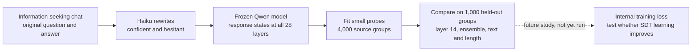

# Confidence Representations for Synthetic Document Training

**Research question:** can we identify an internal signal related to confidence,
then use it to help a model learn target content through Synthetic Document
Training (SDT)? The present work tests the measurement step. It has not yet
tested an additional training loss or shown an SDT improvement.

<!-- SCALEUP_RESULT_START -->
## Current experiment

**An exact set of 5,000 UltraChat response triplets is frozen for analysis.**
Each contains the original answer and two Claude Haiku rewrites intended to
express high and low certainty while preserving the same substantive content.
The researcher found the initial 50 broadly acceptable; item-level human
review of the expanded set remains pending.

The local analysis is running. It compares a layer-14 linear probe with an
equal ensemble of all 28 layers on 1,000 held-out source groups, after fitting
on 4,000 groups. It also reports every layer, text-only and length baselines,
and shuffled-label controls. No result is claimed before that analysis finishes.

[Fixed analysis method](experiments/information_chat_scaleup_v1/README.md)
<!-- SCALEUP_RESULT_END -->

## What the experiment measures

For the same question and answer content, does a small linear readout assign a
higher score to the confident rewrite than to the hesitant rewrite? A score of
90% would mean the intended confident member ranks higher in 900 of 1,000
held-out pairs, if there are no ties. It would not mean that 90% of answers are
correct, or that the model assigns them a 90% probability.

The language model is frozen. It reads each supplied response; it does not
generate a new answer for this analysis. We average its response-token hidden
states at each layer, then fit only the small readout. The source answers are
synthetic ChatGPT conversations, not verified factual ground truth.



## How the earlier work led here

| Study | What it established | What it did not establish |
|---|---|---|
| Initial semantic-entropy pilot | Built and checked the generation, uncertainty-label and activation pipeline | A measure of confidence in a particular written answer |
| Controlled confident/hesitant pairs | Hidden-state readouts can distinguish expressed certainty | Correctness, evidence support or the model's own belief |
| Independent 50-pair cue-holdout challenge | Layer 14 ranked 47/50 pairs correctly; the 28-layer ensemble ranked 48/50, versus 34/50 for character TF-IDF and 25/50 for length | Generality beyond the small controlled construction |
| Fixed-answer evidence diagnostics | Expressed certainty and support for a specific answer can come apart; a separately trained support probe reached 71.9% on its primary comparison | A general confidence scale or a prerequisite that this separate line must pass before expanding paired texts |
| Current 5,000-group study | Tests the paired readout on a much larger, separate information-chat construction | Pending analysis and content review; no training intervention |

The old and new numbers use different datasets and evaluation designs. They
are not a learning curve and should not be compared as a change caused by size.

[Earlier cue-holdout result](experiments/cue_holdout_challenge_v1/RESULTS.md) ·
[Experiment map](docs/experiments/EXPERIMENT_MAP.md) ·
[Historical overview](HISTORY.md)

## Connection to SDT

SDT trains a model on synthetic documents containing target content. The
longer-term proposal is to keep the ordinary training objective and add a
term based on a validated confidence-related representation:

```math
\mathcal{L}_{\mathrm{total}}
=\mathcal{L}_{\mathrm{SDT}}
+\lambda\mathcal{L}_{\mathrm{confidence}}.
```

**The desired outcome is better learning and retention of the target content,
not simply more confident wording.** Before treating this readout as a training
target, we need to audit content preservation and test transfer beyond shared
rewrite cues. A later controlled training study would compare ordinary SDT,
the proposed additional loss, and matched controls, judging success by factual
recall and retention rather than the optimized probe score alone.

## Code and data

| Location | Contents |
|---|---|
| [5,000-group analysis](experiments/information_chat_scaleup_v1/) | Fixed split, extraction, all-layer probes and controls |
| [UltraChat construction](experiments/information_chat_haiku_v1/) | Source filters, Haiku prompt, cache-first generation and review tools |
| [Historical reports](reports/README.md) | Earlier uncertainty, certainty and evidence-support experiments |
| [Historical datasets](datasets/README.md) | Earlier readable experimental inputs |

The two active branches separate the fixed analysis from continued data
generation: `codex/haiku-analysis-5000` and `codex/haiku-expansion-10000`.
The 5,000-group snapshot does not change as generation continues toward 10,000.
Raw chat text, provider returns, account evidence and review records stay in
ignored local directories. Public outputs contain aggregate results and code.

## Sources

The initial uncertainty pilot adapted Kossen et al.'s
[*Semantic Entropy Probes*](https://arxiv.org/abs/2406.15927) and the
[official OATML code](https://github.com/OATML/semantic-entropy-probes).
The paired-certainty study is a separate follow-up, not a full reproduction of
that paper. Current source conversations come from
[UltraChat 200k](https://huggingface.co/datasets/HuggingFaceH4/ultrachat_200k).
The upstream license is preserved.
