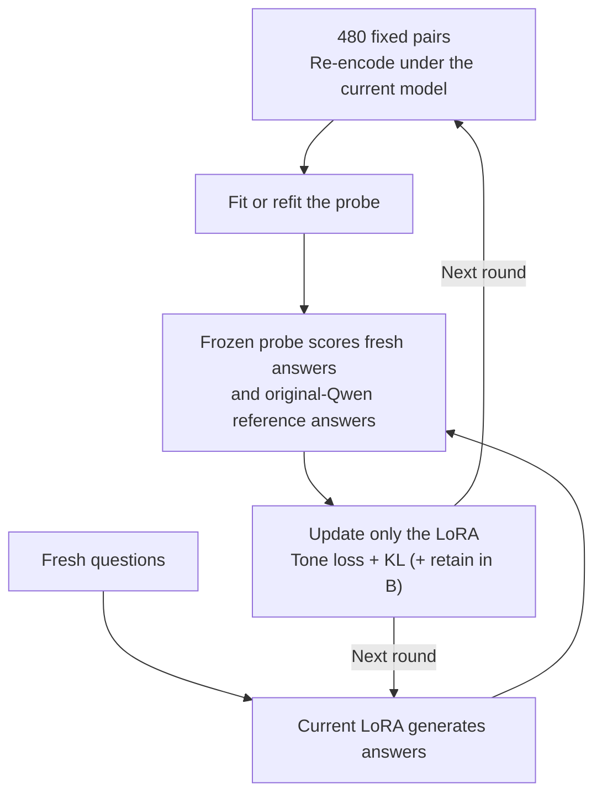
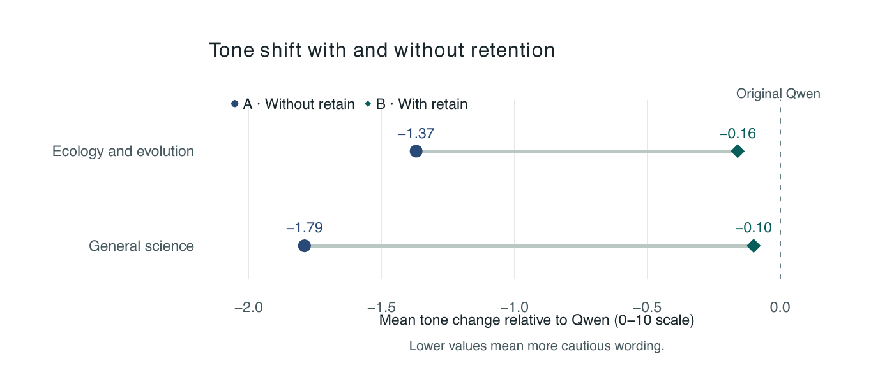

# From a confidence probe to conditional tone control

**Updated November 17, 2026.** The model is **Qwen2.5-1.5B-Instruct**. The probe uses internal activations to estimate **expressed confidence**: how firmly the wording commits to an answer. The supervision comes from answer pairs with different tones. Factual accuracy, token likelihood and calibrated confidence are separate quantities.

## 1. Build pairs that vary tone

Start with a question and two ways of giving the same answer. One is more confident and one is more hesitant. Preserve the central claim, quantities and qualifications. Check content, tone and naturalness. For example, both versions might say that a ticket priced at 45 dollars costs 6 dollars more than the 39 dollars available. The wording can express that conclusion firmly or tentatively.

Fit the probe on labeled pairs and keep evaluation questions separate from fitting. Earlier transfer tests also held out wording families and balanced which version was longer. Text features, answer likelihood and response length provide controls for shortcuts. The [cue-holdout report](../experiments/cue_holdout_challenge_v1/RESULTS.md) documents that earlier test.

## 2. Read internal states with three probe architectures

For the later experiments, Qwen reads the question and the supplied answer. The probe reads hidden states at ordinary answer tokens, using hidden-state index 21 in the model. Each state already contains context from the question and the answer so far. Average the token scores to compare two complete answers.

| Probe | How it works | What the experiment asks |
|---|---|---|
| **Linear** | A weighted sum turns one hidden-state vector into one score. The earlier L14 study applied a linear readout to answer-averaged states. The later matched L21 study scored one answer-token state at a time. | Is the distinction visible in a simple direction? |
| **MLP** | An eight-unit hidden layer with ReLU combines features nonlinearly. The matched L21 MLP still receives one answer-token state at a time. | Does a nonlinear readout help with the same input? |
| **Transformer** | A small causal attention block scores the current answer token using its state and up to 15 earlier answer-token states. | Does giving the probe a short stretch of answer context help? |

For a normalized answer-token state $v$, the two token-local probes score it as follows. The Transformer instead applies causal attention to the state window and maps the current position's output to one score.

```math
\begin{aligned}
f_{\rm linear}(v)&=w^\top v+b,\\
f_{\rm MLP}(v)&=w_2^\top\mathrm{ReLU}(W_1v+b_1)+b_2.
\end{aligned}
```

The matched pilots compared a probe kept fixed during LoRA training with one refitted after every LoRA update. The Transformer varies both capacity and access to earlier token states, so that comparison tests the variant as a whole. The later 480-pair recipe also changed the target loss, so its results do not isolate the effect of dataset size.

## 3. Test whether a probe can change generated answers

**The 480 fixed answer pairs train the probe. Fresh model answers train the LoRA.** The main Qwen weights are frozen during adapter training.

1. Let the current adapter answer a new batch of training questions.
2. Hold the probe fixed and score those fresh answers. In the 480-pair Transformer recipe, compare each answer with the original Qwen's answer to the same question, using the same probe for both. Update the LoRA toward the requested tone. A separate KL term keeps the output distribution near Qwen on neutral anchor examples.
3. Re-encode the same 480 labeled pairs under the updated model and refit the probe on those states. This lets the readout track changes in the adapted model's internal states. Repeat.



### Algorithm pseudocode

This is the 480-pair Transformer training loop used for the general-question adapter and both conditional arms. In the conditional experiment, the training questions are about ecology and evolution, and the tone direction is hesitant in both arms.

```text
Qwen = frozen original model
LoRA = initialized adapter on Qwen
probe, probe_optimizer, scale = fit_initial_probe(Qwen, labeled_pairs_480)
direction = +1 for confident or -1 for hesitant

for round in 1..30:
    questions = sample_16(rollout_training_questions)
    anchors = sample_16(neutral_anchors)

    # 1. Generate fresh answers. Qwen, LoRA and probe weights stay fixed.
    fresh = generate_without_grad(Qwen + LoRA, questions)

    # 2. Compute the losses. The two scores use the same frozen probe.
    # Fresh answer tokens are fixed; gradients flow through their new forward pass.
    current = mean_token_probe_scores(probe, Qwen + LoRA, questions, fresh, scale)
    reference = no_grad(mean_token_probe_scores(
        probe, Qwen, questions, cached_Qwen_answers[questions], scale))
    tone_loss = mean(relu(0.5 - direction * (current - reference)))
    loss = tone_loss + 16 * forward_KL(Qwen, Qwen + LoRA, anchors)

    if arm is B and round > 3:
        retain_batch = sample_16(non_target_question_and_Qwen_answer_pairs)
        retain_loss = layer21_state_distance(Qwen, Qwen + LoRA, retain_batch)
        loss += retain_weight(round) * retain_loss

    # 3. Update LoRA only. Base Qwen and the probe stay frozen.
    lora_optimizer_step(loss)

    # 4. Freeze Qwen and the updated LoRA; update only the probe.
    states = encode_without_grad(Qwen + LoRA, labeled_pairs_480, hidden_state=21)
    refit_probe(probe, probe_optimizer, states, original_labels, scale, steps=2000)
    freeze(probe)  # Carry its new weights into the next round.
```

### How the probe is refitted

1. Feed the same 480 labeled pairs (960 fixed answers) through **Qwen with the newly updated LoRA**. Save the states at ordinary answer tokens. For the Transformer, each scoring window includes the current position and up to 15 earlier answer positions from the same answer.
2. Keep the supplied labels. Each confident answer's tokens have label **+1**, and each hesitant answer's tokens have label **−1**. The freshly generated answers are used for the LoRA step above.
3. Continue from the existing probe weights and AdamW optimizer state. Take **2,000 probe-only steps** per round, each on a batch of **32 sampled answer-token positions**. Use the token-level hinge loss below and the original activation scale. The Qwen and LoRA weights stay fixed throughout the refit.

Both conditional arms **A and B** refit the probe. B differs at the LoRA update, where it adds retain loss from round 4. In the earlier frozen-probe controls, the adapter took its LoRA step each round and the probe kept its initial weights.

### Losses used during training

Let $0$ denote frozen Qwen, $\theta$ the LoRA parameters, and $\phi$ the probe weights. For a question $x$ and answer $y$, write $A(y)$ for its ordinary answer-token positions. At token $i$, the probe input $u_{\theta,i}$ is its layer-21 state for the token-local probes, or the corresponding causal window for the Transformer. With the training activation scale $r$ fixed, the answer score is

```math
s_\phi(\theta;x,y)=\frac{1}{|A(y)|}\sum_{i\in A(y)} f_\phi\!\left(\frac{u_{\theta,i}}{r}\right).
```

**Fit the probe.** A confident answer supplies label $z=+1$ to its answer tokens, and a hesitant answer supplies $z=-1$. The later token-level probes minimize the mean hinge loss over the sampled labeled answer tokens. Here $[a]_+=\max(0,a)$.

```math
\mathcal L_{\rm fit}=\mathbb E_{\rm labeled\ answer\ tokens}\!\left[\bigl(1-z f_\phi(u_{\theta,i}/r)\bigr)_+\right].
```

**Update the LoRA.** In the 480-pair recipe, let $y_\theta$ be the fresh answer from the current adapter and $y_0$ the saved answer that original Qwen generated to the same question. Score both with the same current probe $\phi$, held fixed during the LoRA update. The sampled answer tokens are fixed for this update. Gradients pass through the probe and the model states computed on those tokens to the LoRA parameters. Use target sign $d=+1$ for more confident wording and $d=-1$ for more hesitant wording. The target gap $m=0.5$ is in raw probe-score units.

```math
\mathcal L_{\rm tone}=\mathbb E_x\!\left[\Bigl(m-d\bigl(s_\phi(\theta;x,y_\theta)-s_\phi(0;x,y_0)\bigr)\Bigr)_+\right].
```

For example, in the hesitant direction, an answer earns zero tone loss once its score is at least 0.5 below its Qwen reference. The earlier matched 240-pair pilots used an absolute token-level hinge. The 480-pair recipe uses this reference-relative, answer-averaged gap.

**Anchor the output distribution.** On a separate neutral set, run frozen Qwen and the adapted model on the same fixed response prefixes. The forward KL averages the difference in next-token distributions over answer-token prediction positions.

```math
\mathcal L_{\rm KL}=\mathbb E_{\rm neutral\ answer\ prefixes}\!\left[D_{\rm KL}\!\left(p_0(\cdot\mid\text{prefix})\,\|\,p_\theta(\cdot\mid\text{prefix})\right)\right].
```

Evaluate the finished adapter on new questions using a shared neutral prompt. A blinded judge scores the wording of the generated explanation from 0 to 10. The answer key separately checks the model's selected option. The general-question Transformer LoRA shifted tone by about **−1.0 on MMLU** and **−0.7 on Science Bowl biology**, relative to original Qwen. The MMLU shift also appeared in answers without the common hedges checked in a follow-up analysis. [Public evaluation report](../reports/circuit-breakers-confidence-2026-11-17.md)

## 4. Limit where the tone changes

The conditional experiment uses fresh answers to **ecology and evolution questions** for the probe-guided LoRA updates. At evaluation, the same adapter is used for every domain under the same prompt.

### Circuit Breakers and our adaptation

**Original Circuit Breakers.** Algorithm 1 separates the examples on which representations should move from the examples on which they should be retained. With $h_0$ from the frozen model and $h_\theta$ from the adapted model, the original target term penalizes positive cosine similarity. The retain term penalizes Euclidean distance on its retain examples. The algorithm combines the two terms with scheduled weights. [Zou et al., Algorithm 1 and §3](https://arxiv.org/html/2406.04313)

```math
\begin{aligned}
\mathcal L_{\rm CB,target}&=[\cos(h_0,h_\theta)]_+, &
\mathcal L_{\rm CB,retain}&=\|h_\theta-h_0\|_2,\\
\mathcal L_{\rm CB}&=c_s\,\mathcal L_{\rm CB,target}+c_r\,\mathcal L_{\rm CB,retain}.
\end{aligned}
```

**Our conditional experiment.** The signed probe loss supplies the target objective on ecology and evolution questions. The retain term uses non-target questions. Both models read the same non-target question and original-Qwen answer. At each corresponding answer token, compare their layer-21 state vectors. Average the Euclidean distances over those $N_{\rm ret}$ tokens and divide by the square root of the hidden width $D$.

```math
\mathcal L_{\rm retain}=\frac{1}{N_{\rm ret}}\sum_{\rm retain\ answer\ tokens}\frac{\|h_{\theta,i}-h_{0,i}\|_2}{\sqrt D}.
```

The two arms share the target objective and the neutral-output KL. Only B adds activation matching. Its retain weight $\lambda_k$ is zero for the first three updates and increases linearly over the remaining updates to a training-calibrated weight.

```math
\mathcal L_A=\mathcal L_{\rm tone}+16\,\mathcal L_{\rm KL},\qquad \mathcal L_B=\mathcal L_A+\lambda_k\,\mathcal L_{\rm retain}.
```

| Evaluation domain | A · Tone change vs. Qwen | B · Tone change vs. Qwen |
|---|---:|---:|
| Ecology and evolution | −1.37 | −0.16 |
| General science (physics, earth science and astronomy) | −1.79 | −0.10 |

Lower means more cautious. The retain loss reduced the shift outside the target domain and weakened the intended shift inside it. The [public report](../reports/circuit-breakers-confidence-2026-11-17.md) gives the separate accuracy results, scorable counts and uncertainty intervals. Whether the adapter can preserve both a meaningful target shift and baseline behavior elsewhere remains open.



The plot shows mean changes. Uncertainty intervals and accuracy counts are in the public report.

**Next experiment.** Compare **120 vs. 480 distinct target questions** with the same number of generated training answers and LoRA steps. Run both retain conditions at each scale. This tests whether greater question coverage helps at a fixed training budget.

## References

- [Kossen et al., *Semantic Entropy Probes* (2024)](https://arxiv.org/abs/2406.15927) informed the early hidden-state readout work. That paper's target is semantic entropy.
- [Libon et al., *Alignment via Training Against Probes Without Losing Monitorability*, v3 (2026)](https://arxiv.org/abs/2609.38645v3) informed the alternate rollout, LoRA update and probe refit loop. This project uses a tone objective with its own matched answer data.
- [Zou et al., *Improving Alignment and Robustness with Circuit Breakers* (2024)](https://arxiv.org/html/2406.04313) supplied the activation-retention idea. The target objective here uses expressed tone.
