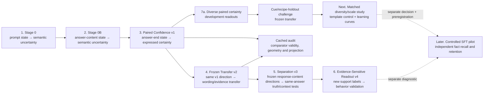

# Research Sequence and Methods

These experiments do **not** share one target, token position, or fitted
direction. To avoid calling several different measurements “the confidence
probe,” this repository uses the following names.

| Step | Canonical name | What is predicted or compared? | Hidden state used | Data used to fit the readout |
|---:|---|---|---|---|
| 1 | **Stage 0 — Prompt-State Semantic-Uncertainty Probe** | Whether multiple future sampled answers have high or low semantic entropy | Layer 14 at the **final rendered prompt token, before any answer** | SQuAD questions; semantic-entropy labels made from locally generated answer samples |
| 2 | **Stage 0B — Answer-State Semantic-Uncertainty Diagnostic** | Whether nine alternative answers have high or low semantic entropy after one answer is observed | Layer 14 at the **final ordinary token of the observed answer** | The same cached 500-question SQuAD run; answer 0 supplies the state and answers 1–9 supply the label |
| 3 | **Paired Confidence v1 — Answer-End Expressed-Certainty Readout** | Whether a fixed written response is phrased confidently or with a hedge | Layer 14 at the assistant **`<\|im_end\|>` token after the complete response** | Paired confident/hedged rewrites from SQuAD, arithmetic/logic and selected MMLU sources |
| 4 | **Frozen Transfer v2 — Expressed-Certainty Evidence-Transfer Test** | Whether the unchanged v1 readout transfers to new wording and to identical answers with versus without target evidence | The same layer-14 **post-response `<\|im_end\|>` token** | **No v2 fitting.** The direction is frozen from Paired Confidence v1 |
| 5 | **Confidence–Correctness Separation v3** | Whether identical answers score higher when correct under counterfactual contexts; wording and omitted-role controls | Frozen v1 layer-14 **final response-content token** and **response-content mean**; end marker as reference | **No v3 fitting.** Confidence vectors are unchanged; comparator contrasts use only old v1 train/A-B sources |
| 6 | **Evidence-Sensitive Readout v4** | Whether support for a fixed answer transfers across source/template splits and agrees with independent output behavior | Layer 14 **response-content mean**, excluding end marker | New support-versus-contradiction pairs from 96 training records; fixed paired logistic regression, C=0.01 |
| 7a | **Diverse Paired Certainty + Multi-Layer Development Diagnostic** | Whether same-content certainty wording is decodable across diverse source content, and whether all-layer averaging beats layer 14 | Mean of ordinary assistant-response tokens at each of 28 layers; last response token is secondary | 50 real-source development pairs; five source-disjoint folds; paired logistic readouts fitted within each fold |
| Current | **Cue/Recipe-Holdout Transfer Challenge** | Whether the frozen development readouts order new same-content pairs built from held-out cue families, beyond text, likelihood and length controls | The same response-token means at layer 14 and all 28 layers | **No challenge fitting.** Development-only scalers and readouts are frozen and applied once to 50 locked pairs |
| Next | **Matched Diverse-vs-Template Scale Study** | Whether diverse rewriting improves transfer over a fixed-template baseline, and how performance changes with 100/300/700 training sources | The same response-token means at layer 14 and all 28 layers | Not yet run; human review, grouped source expansion and one locked natural test set come first |
| Later | **Controlled synthetic-fact training pilot** | Whether the frozen layer-14 objective improves recall and retention beyond matched controls | Completed-answer states, to be fixed in a separate preregistration | No language-model training has run; it requires a new decision after the diverse-pair handoff |

Use the full names at first mention. Short forms are `Stage 0`, `Stage 0B`,
`Paired Confidence v1`, `Frozen Transfer v2`, and `Separation v3`. In particular:

- Stage 0 and Stage 0B are **semantic-uncertainty** experiments.
- Paired Confidence v1 is an **expressed-certainty** experiment.
- Frozen Transfer v2 tests **wording transfer and supplied-context
  sensitivity**; it does not create a new probe.
- Separation v3 holds answer text fixed while its contextual correctness changes.
- Evidence-Sensitive Readout v4 fits contextual support on fresh training data;
  it is a different readout, with independent output-behavior validation.
- The diverse-pair follow-up fits new response-mean readouts across all 28 layers.
  Its development ceiling was shared by character TF-IDF and strong length/NLL
  controls, so it validated separability and implementation rather than an
  abstract confidence mechanism.
- The cue/recipe-holdout challenge freezes those development readouts and tests
  50 new pairs. Layer 14 reached 47/50, versus 34/50 for character TF-IDF,
  30/50 for answer likelihood and 25/50 for length. This supports transferable
  expressed-certainty information, not subjective belief or correctness.
- The cached confidence/correctness audit is supplementary post-hoc analysis of
  existing v1/v2 caches, not another independently confirmed experiment.
- None of these experiments directly labels subjective confidence or proves
  a causal confidence mechanism.

Paired Confidence v1 also has internal **Phase A** and **Phase B** scale-up
steps. Those are parts of v1 and must not be confused with the separate project
experiment named **Stage 0B**.

## How Paired Confidence v1 was built

### Data

Phase B contains 120 source questions: 40 cached SQuAD questions, 40
mechanically checked arithmetic/logic questions, and 40 selected MMLU questions.
The grouped split is 72 training, 24 validation, and 24 test sources. All
variants of one source remain in one split.

Each source has three rewrite families (A/B/C). Within each family, the same
source produces four cells:

```text
correct + confident     correct + hedged
wrong   + confident     wrong   + hedged
```

This gives 12 responses per source and 1,440 responses overall. Confident and
hedged versions preserve the answer proposition; therefore v1 can be tested
separately on correct and deliberately wrong content. Families A/B from the 72
training sources fit the direction: 576 response rows forming 288
confident/hedged differences. Family C is excluded from fitting. The primary
held-out endpoint uses family C on the 24 unseen test sources: 48 pairs, one
correct-content pair and one wrong-content pair per source.

### Calculation

Qwen is frozen and reads each complete written response in teacher-forcing mode.
Let $h^{\mathrm{confident}}_{qkf}$ and
$h^{\mathrm{hedged}}_{qkf}$ be the layer-14 states at the response-end
`<|im_end|>` token for source $q$, correctness cell $k$, and training
rewrite family $f\in\{A,B\}$. First compute the paired difference:

```math
d_{qkf}=h^{\mathrm{confident}}_{qkf}-h^{\mathrm{hedged}}_{qkf}.
```

Average the four A/B × correct/wrong differences within each training source,
then average the 72 sources equally and normalize:

```math
\bar d_q=\operatorname{mean}_{k,f}d_{qkf},\qquad
v=\frac{\operatorname{mean}_q\bar d_q}
        {\left\|\operatorname{mean}_q\bar d_q\right\|_2}.
```

A new response receives the raw score

```math
s(h)=v^\top h.
```

Here $v^\top h$ is a dot product, not a calibrated probability. V1 counts a
pair as correct when the confident version has the higher score. It does not
fit a threshold, scaler, logistic regression, or dimension selector for this
primary direction.

V1 ordered all 48 held-out family-C test pairs correctly, including both
correct and wrong answer content. The measured target is **expressed certainty**.
Twelve of 200 source-sign-shuffled directions also reached 100%, and the TF-IDF
control tied on 42 of 48 pairs. Those controls do not establish a unique direction
or removal of lexical cues. The [v1 report](../../reports/PAIRED_CONFIDENCE_RESULTS_V1.md)
records all checks, including content review by research agents and rules rather
than human annotation.

V3 constrains the interpretation as evidence-sensitive factual confidence.
V4 therefore tests a new measurement before the
[deferred functional comparison](NEXT_EXPERIMENT.md).

## How Evidence-Sensitive Readout v4 is fitted

V4 has 96 training, 24 validation and 48 test records. Context, question and
neutral-response templates are disjoint by split, as are entity names and
candidate values. Each training record supplies both candidate answers under
supporting and contradicting evidence, using identical neutral response text.

For each source q and candidate a, form the layer-14 response-mean difference:

```math
\Delta h_{q,a}=h_{q,a}^{\mathrm{supported}}-h_{q,a}^{\mathrm{contradicted}}.
```

Fit logistic regression to these differences and their sign-reversed copies,
with balanced labels, no intercept, L2 regularization C=0.01 and scaling fitted
only on that training pool. Convert coefficients back to raw-state coordinates
and unit-normalize. The score of a new state is:

```math
s(h)=v^\top h.
```

The sigmoid is not the model's probability of being correct. Test omissions
and certainty styles never fit the direction. Validation does not tune a
layer, sign or regularization value. The
[v4 design](EVIDENCE_CONFIDENCE_V4_PREREGISTRATION.md) requires neutral evidence
ordering, style robustness and comparison with shuffled-label controls.

Independent question paraphrases yield 144 greedy answers and candidate
sequence likelihoods. The probe's candidate margin must correlate with these
output preferences overall and after centering by evidence condition and fact
schema. This avoids accepting a correlation explained only by those broad
groups. Passing remains controlled convergent evidence, with ambiguity and
natural-answer transfer still to test.

## How the current cue-holdout readout is fitted

The current challenge uses a new development-trained readout, not the original
v1 mean-difference vector. For response member $c\in\{+,-\}$ and layer $\ell$,
ordinary assistant-response token states are averaged while chat-template
boundary tokens are excluded:

```math
h_{i,c}^{(\ell)}
=
\frac{1}{|T_{i,c}|}
\sum_{t\in T_{i,c}} H_{i,c,t}^{(\ell)}.
```

At each layer, a featurewise standardizer is fitted on both members of all 50
development pairs and never refitted on the challenge:

```math
z_{i,c}^{(\ell)}
=
\operatorname{scale}_{\mathrm{dev}}\!\left(h_{i,c}^{(\ell)}\right),
\qquad
\Delta_i^{(\ell)}=z_{i,+}^{(\ell)}-z_{i,-}^{(\ell)}.
```

A no-intercept L2 logistic regression with $C=0.01$ is fitted to the symmetric
development examples $(\Delta_i^{(\ell)},1)$ and
$(-\Delta_i^{(\ell)},0)$. Its frozen response score is

```math
s_\ell(h)=w_\ell^\top\operatorname{scale}_{\mathrm{dev}}(h).
```

Layer 14 is the prespecified primary readout. For the fixed ensemble, each
layer score is standardized using only its distribution across development
responses, then all 28 standardized scores are averaged with equal weight:

```math
S(h)
=
\frac{1}{28}\sum_{\ell=1}^{28}
\frac{s_\ell(h)-m_{\ell,\mathrm{dev}}}
     {r_{\ell,\mathrm{dev}}}.
```

Pair-ordering accuracy is the fraction of the 50 locked challenge pairs for
which the confident member receives the higher frozen score:

```math
\operatorname{accuracy}
=
\frac{1}{50}\sum_{i=1}^{50}
\mathbf 1\!\left[s(h_{i,+})>s(h_{i,-})\right].
```

No challenge label, threshold, sign, layer or ensemble weight is fitted or
selected. Character TF-IDF is separately fitted on development text only;
answer likelihood and token length are direct controls. The
[challenge result](../../experiments/cue_holdout_challenge_v1/RESULTS.md)
reports the frozen comparison.

## Relationship between the experiments



The arrows show the research sequence, not reuse of one fitted vector. Stage 0,
Stage 0B and Paired Confidence v1 each estimate a different readout. Only Paired
Confidence v1 supplies the frozen, position-specific directions for v2 and v3.
The cached audit estimates correctness contrasts solely on old v1 training data.
It never fits them on v2/v3 outcomes.

See the [Stage 0/0B report](../../reports/RESULTS_STAGE0.md),
[Paired Confidence v1 report](../../reports/PAIRED_CONFIDENCE_RESULTS_V1.md), and
[Frozen Transfer v2 report](../../reports/CONFIDENCE_TRANSFER_RESULTS_V2.md),
[fresh v3 report](../../reports/CONFIDENCE_SEPARATION_RESULTS_V3.md), and
[cached audit](../../reports/CONFIDENCE_CORRECTNESS_AUDIT.md) for results and
limitations.

V4 is complete: support-versus-contradiction ordering is 71.9%, but omission and
behavior validation failed. See the [v4 report](../../reports/EVIDENCE_CONFIDENCE_RESULTS_V4.md).
The cue-holdout challenge is complete: layer 14 reached 94% and the frozen
ensemble 96%, while the prespecified text, likelihood and length controls reached
68%, 60% and 50%. See the
[challenge result](../../experiments/cue_holdout_challenge_v1/RESULTS.md).
The immediate next study is the matched diversity/scale comparison documented
in the [next decision](../../experiments/diverse_pairs_multilayer_v1/NEXT_DECISION.md).
The dashed arrows remain a proposal boundary; no training experiment has run.
