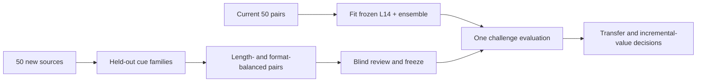

# Cue/recipe-holdout certainty challenge

## Why this experiment exists

The preceding 50-pair development study reached 50/50 at layer 14 and with an
equal 28-layer ensemble. Character TF-IDF also reached 50/50, negative mean NLL
49/50 and response length 47/50. That result validates separability and the
pipeline, but the data is too easy to test whether the readout transfers beyond
the original rewrite recipe.

This challenge is the smallest useful follow-up. It remains on the diverse,
same-content expressed-certainty line proposed by Cas. It is not an
evidence-support experiment, an SDT loss experiment, activation steering or a
claim about subjective belief.

## Design

- 50 new, independent source groups: 10 per task category.
- Every source must have a clear focal answer or conclusion whose certainty can
  be expressed naturally within the substantive discourse. Pure inventories or
  outlines that would require a generic whole-answer endorsement wrapper are
  inapplicable.
- Source selection is quality-first and is not balanced by dataset within each
  task. The public freeze records the actual per-task and overall counts without
  claiming exact balance unless it is achieved.
- Every locked pair carries its frozen source dataset (`nvidia/HelpSteer2` or
  `allenai/WildChat-1M`), which is checked against the source-selection manifest
  before evaluation.
- Five held-out cue families, represented twice within every task.
- Both the confident and hesitant versions are rewritten; the source response is
  not reused unchanged as the default confident member.
- The confident member is longer in exactly 25 pairs and the hesitant member in
  exactly 25, with matched formatting and a target difference of at most three
  tokenizer tokens.
- Source IDs, pair text, cue family and length direction are frozen before any
  challenge activation is inspected.
- Content and tone review is blinded. Agent QA is a pre-screen and never counts
  as human review.

Manual semantic source-quality and applicability review is agent-audited
development QA, not human validation.

## Evaluation boundary

The primary pilot-transfer criterion is at least 35/50 correct layer-14 pair
orderings with a source-bootstrap lower bound above 50%. TF-IDF, NLL and length
are reported as separate controls. A tied control does not prove that the probe
is merely lexical; it means incremental predictive value has not been shown.
Shuffled-training runs are descriptive rather than a pass/fail gate.
Dataset counts and dataset-stratified paired rankings are also reported only as
exploratory diagnostics. They are not a pass/fail criterion and must not be
used to select a readout, layer, sign, threshold or dataset.

Even a pass would establish only transferable **expressed certainty**. Using a
readout as an internal training loss would still require target-appropriate
validation and a preregistered learning-and-retention experiment.

## Files

| Material | Location |
|---|---|
| Frozen parent decision rules | [../diverse_pairs_multilayer_v1/NEXT_CHALLENGE.md](../diverse_pairs_multilayer_v1/NEXT_CHALLENGE.md) |
| Rewrite contract and cue families | [REWRITE_SPEC.md](REWRITE_SPEC.md) |
| Public source inventory | `manifests/` |
| Cross-task microbatch preparer and freeze | `src/prepare_cross_task_microbatch.py`, `manifests/cross_task_microbatch_manifest.json` |
| Source selection and later evaluation code | `src/` |
| Invariant tests | `tests/` |
| Source and rewritten text | `private_data/`, local and ignored |
| Hidden-state cache | `cache/`, local and ignored |

Third-party response text and rewrites are never added to Git. Public artifacts
contain code, hashes, aggregate coverage and aggregate results only.

## Current status

The 50-pair challenge is frozen after score-free source curation, mechanical
validation, cross-batch shortcut screening and two complete independent blind
reviews. The final set has 10 pairs per task, 10 per cue family and one of each
length direction in every task-by-family cell. Both reviewers found 50/50
content preservation, 50/50 intended certainty ordering, no formatting
failure and no material shortcut concern. Minor concerns remain descriptive
and did not trigger the preregistered repair gate.

The public lock manifest binds the exact source selection, validated rewrites,
randomized A/B packet, mapping and two decision files by SHA-256. Review was
performed by agents, so the set is explicitly marked
`agent_reviewed_development_only`, not human validated. No challenge activation
had been inspected when the set was locked. The next and only score-bearing
step is the frozen one-shot evaluation.
