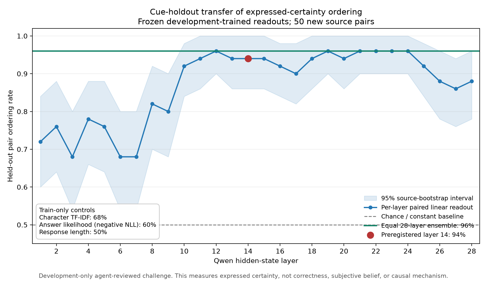
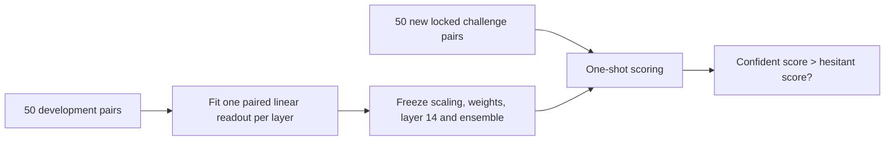

# Cue-holdout challenge: results

## Conclusion

**The frozen hidden-state readout transferred to new sources and new certainty
constructions, while substantially outperforming text, likelihood and length
controls. This rules out the tested text, likelihood and length controls as a
complete explanation of the hidden-state result and supports continuing the
research.**

The layer-14 readout was specified and frozen before challenge scoring. It
ranked the confident response above its content-matched hesitant counterpart in
**47/50 pairs (94%; 95% source-bootstrap interval 86–100%)**. The fixed equal
28-layer ensemble ranked **48/50 (96%; 90–100%)**. Both readouts were fitted
only on the original 50 development pairs and applied once to the locked
challenge.

This result supports a narrow claim: Qwen 2.5 1.5B contains a transferable
linear signal for **expressed certainty about preserved answer content** in
these supplied responses. It does **not** establish the model's subjective
belief, correctness, evidence-sensitive confidence, a localized mechanism, or
the benefit of adding this score to a training loss.

## Why this test was needed

The original diverse-pair development set gave perfect hidden-state scores,
but character-only text features also achieved 100% and response length achieved
94%. That dataset therefore showed decodability without showing that the
readout generalized beyond its wording recipe.

The challenge addresses that confound with 50 new source groups:

- 10 pairs in each of five tasks;
- 10 pairs in each of five held-out cue families;
- exactly one confident-longer and one hesitant-longer pair in every
  task-by-family cell;
- 25/25 length direction overall, with every pair within three tokens;
- 35 HelpSteer2 and 15 WildChat sources;
- two complete independent blinded agent reviews before any activation score
  was inspected.

The source groups, normalized prompts and original responses are disjoint from
the development set. The final packet, mapping, reviewer files and locked pairs
are hash-bound in the [freeze manifest](manifests/locked_pairs_freeze_manifest.json).
The review status is `agent_reviewed_development_only`, not human validated.

## Exact readout

For each response and layer, the model is run on the complete prompt and
supplied answer. Hidden states are averaged over answer-content tokens, excluding
chat-template boundary tokens. Let that response representation be
$h_{i,+}^{(\ell)}$ for the confident member and $h_{i,-}^{(\ell)}$ for the
hesitant member.

Feature means and variances are fitted on development responses only:

$$
z_{i,+}^{(\ell)} = \operatorname{scale}_{\text{dev}}(h_{i,+}^{(\ell)}),
\qquad
z_{i,-}^{(\ell)} = \operatorname{scale}_{\text{dev}}(h_{i,-}^{(\ell)}).
$$

For every development pair, the training vector is the paired difference:

$$
\Delta_i^{(\ell)} = z_{i,+}^{(\ell)} - z_{i,-}^{(\ell)}.
$$

A no-intercept logistic regression with $C=0.01$ is fitted symmetrically to
$(\Delta_i^{(\ell)},1)$ and $(-\Delta_i^{(\ell)},0)$. A new response then
receives the scalar score

$$
s_\ell(h) = w_\ell^\top\operatorname{scale}_{\text{dev}}(h).
$$

A challenge pair is correct when
$s_\ell(h_+) > s_\ell(h_-)$. The ensemble averages all 28 layer scores after
standardizing each layer with development-score statistics. No challenge label,
threshold, sign, layer or ensemble weight is fitted or selected.

## Frozen evaluation results

| Method | Correct ordering | 95% interval | Wins / losses |
|---|---:|---:|---:|
| **Layer 14 hidden-state readout** | **94%** | **86–100%** | **47 / 3** |
| **Equal 28-layer ensemble** | **96%** | **90–100%** | **48 / 2** |
| Character TF-IDF | 68% | 54–80% | 34 / 16 |
| Negative mean answer NLL | 60% | 46–72% | 30 / 20 |
| Counterbalanced answer length | 50% | 36–64% | 25 / 25 |

Relative to layer 14, the paired accuracy gaps were:

| Comparison | Layer-14 advantage | 95% interval |
|---|---:|---:|
| vs. character TF-IDF | **+26 points** | **+14 to +40** |
| vs. answer likelihood | **+34 points** | **+20 to +48** |
| vs. response length | **+44 points** | **+30 to +58** |

The simple mean confident-minus-hesitant activation direction matched the
logistic readout exactly at layer 14 (94%) and in the all-layer ensemble (96%).
This suggests a simple, broadly shared direction is sufficient on this test;
it does not identify a unique mechanism.

In 200 descriptive shuffled-training-orientation fits, layer 14 averaged 51.0%
and the ensemble averaged 50.5%. Seven shuffled layer-14 fits reached at least
94%; one shuffled ensemble fit reached at least 96%. These counts are useful
null diagnostics, not formal p-values.

## Layer and subgroup pattern

Early layers were weaker (68–82% across layers 1–9). Accuracy rose to 92% at
layer 10 and stayed between 90% and 96% through layer 25 before falling to
86–88% in the final two layers. Layer 14 was fixed in advance; several other
layers reached 96%, so the result does not make layer 14 mechanistically
special. The ensemble's two-point advantage over layer 14 has a paired interval
of 0–6 points and does not justify preferring the more complex readout for a
small training pilot.

Descriptive subgroup results were consistent but small:

- layer 14 achieved 100% on factual explanation and math/logic, and 90% on
  comparison, programming and summary/judgment;
- it achieved 100% on embedded, compositional and contrastive cues, 90% on
  modal cues and 80% on discourse-level calibration;
- it achieved 93.3% on WildChat and 94.3% on HelpSteer2 sources.

Each task or cue-family cell contains only 10 pairs. These diagnostics were not
used for selection, gating or post-hoc tuning.

## Failure analysis and limits

The three layer-14 errors were concentrated in discourse-level calibration
(two) and modal force/scope (one). The ensemble corrected one discourse error,
leaving one discourse and one modal error. This is compatible with the intended
harder constructions, but 10 examples per family are too few for a stable
family ranking.

Important limits remain:

1. **The target is expressed certainty.** The model read supplied answers; this
   is not evidence that it accurately reports its own uncertainty.
2. **Lexical information remains.** TF-IDF reached 68%, so wording contributes
   even though it cannot explain the hidden-state result fully.
3. **The challenge is small and agent reviewed.** Human review is still pending.
4. **The signal is distributed.** Many middle and late layers perform well;
   probing alone does not localize or establish a causal mechanism.
5. **No correctness or evidence test is implied.** Those are separate diagnostics,
   and earlier evidence-support work did not validate a general confidence scale.
6. **No training claim has been tested.** A high readout score could reward
   assertive language rather than better fact learning unless the pilot includes
   matched behavioral controls.

## Research decision

**Continue, using layer 14 as the simplest frozen readout, but keep the target
name narrow and do not claim a validated general-confidence mechanism.** The
next step should be a very small, preregistered synthetic-fact training pilot
after a human blind audit of this already locked challenge. The challenge must
not be rewritten or used for hyperparameter selection.

The pilot should compare:

1. ordinary synthetic-document training;
2. the same training plus a frozen layer-14 score loss;
3. a matched random-direction loss;
4. an output-only confidence or answer-token-weighting control.

The main outcomes should be fact recall on new question phrasings, retention
after matched interference, ordinary likelihood/calibration, and unchanged
performance on unrelated material. Improvement must be judged independently of
the score being optimized. Activation steering and larger-scale training remain
out of scope until that controlled pilot is designed.

## Reproduction and provenance

- Configuration: [configs/cue_holdout_challenge_v1.yaml](configs/cue_holdout_challenge_v1.yaml)
- Public result: [results/challenge_evaluation.json](results/challenge_evaluation.json)
- Plot script: [src/plot_challenge_results.py](src/plot_challenge_results.py)
- Freeze manifest: [manifests/locked_pairs_freeze_manifest.json](manifests/locked_pairs_freeze_manifest.json)
- Rewrite and review contract: [REWRITE_SPEC.md](REWRITE_SPEC.md)
- Full mechanical QA: [reports/rewrite_validation_full_50_summary.json](reports/rewrite_validation_full_50_summary.json)

The evaluation used 200 local forward passes, zero generation calls and no
challenge fitting. Wall time was 416 seconds. Raw third-party text, paired
rewrites, review packets, activations and caches remain local and Git-ignored.
