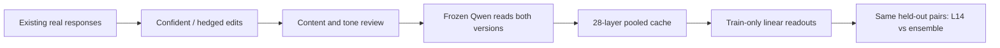

# Diverse paired certainty: measurement plan

Version 0.2, 11 October 2026. Extraction and primary readout choices were specified
before the 50-pair development diagnostic. **The final source split and held-out
rewrite recipe are not frozen. No final-test performance has been measured.**

## What we are testing

Can Qwen's internal states distinguish more certain from more hesitant
expressions of the same answer across new content and wording? Does combining
layers improve on a freshly fitted layer-14 readout on the same data?

The target is **expressed certainty about preserved answer content**. It is not
correctness, evidence support, semantic entropy, or a calibrated probability that
the answer is true. The earlier experiments remain independent diagnostics.
No language-model training, activation steering or SDT loss experiment is run.



## Data and review

The current pilot contains 50 development sources: 38 WildChat and 12 HelpSteer2.
Source authors, the GPT-6 Luna rewriter and the frozen Qwen representation model
have different roles. Qwen reads other models' text; these are not the source
authors' original activations.

Revision 2 changed only hesitant responses after the user's tone feedback.
An agent audit then kept 40 pairs and flagged 10 for targeted correction.
Revision 3 incorporates those corrections; a separate agent pass accepted all
50. The same configured model family performed rewriting and QA, so shared style
artifacts remain possible. **This is agent-assisted QA, not human review.** All
50 remain pending individual human review, and known source-answer errors are
recorded rather than silently fixed.

Actual exports from the local review page can be imported with
`src/import_reviews.py`. It checks the packet and response hashes and randomized
A/B mappings, retains the original export, and writes a separate reviewed file.
Only content-preserving, correctly ordered, unconfounded pairs pass individually.
The proposed pilot quality thresholds are 95% content preservation and 90%
clear certainty ordering after all 50 have been annotated. Passing them does not
automatically authorize a larger rewrite budget.

The earlier scale target was about 1,000 independent source groups. The completed
development diagnostic does **not** justify that expansion: the current rewrite
recipe is separable by cheap text, NLL and length controls. The next dataset is
instead a small independent challenge set. All pilot sources and derivatives stay
outside it; source groups, certainty-cue families and the actual held-out recipe
must be frozen before its scores are exposed.

## Exactly which hidden states

Input is the unchanged source user prompt and one written assistant response,
using Qwen's local chat template and a common system prompt. Qwen is not asked to
generate an answer. Labels, dataset names and rewrite instructions are absent
from the model input.

- **Primary:** mean of every ordinary assistant-response token state.
- **Auxiliary:** last ordinary assistant-response token, with its text and
  punctuation status recorded privately.
- **Negative control:** last prompt token; the prompt is identical within a pair.

Prompt, end-of-turn/EOS and padding tokens are excluded from response pooling
and NLL. Nothing is silently truncated. The input is capped at 1,024 tokens and
the response at 512. Batch size is 1 with a common right-padded length per pair.

Indices follow the installed Transformers Qwen2 API: `hidden_states[0]` is the
embedding state; indices 1–27 follow blocks 1–27; index 28 is the final block
state **after final RMSNorm**. This last index is not an unnormalized block
output. A tiny randomly initialized Qwen2 test compares API states with hooks
to verify this convention; production extraction uses the API, not hooks.

The pinned, unquantized local Qwen2.5-1.5B snapshot is
`989aa7980e4cf806f80c7fef2b1adb7bc71aa306`. Device preference is MPS, CUDA, CPU;
accelerators use FP16, CPU FP32. Cache keys include input IDs, per-pair padding,
full weight/tokenizer hashes, template hash, software versions, dtype/device,
layer convention and implementation hash. Only pooled FP16 states persist,
along with token IDs, masks, offsets and same-response NLL.

## Readout and comparison

For layer ℓ, fit the scaler on **training responses only**:

```math
z_\ell=(h_\ell-\mu_{\ell,\mathrm{train}})/\sigma_{\ell,\mathrm{train}},
\qquad d_{i,\ell}=z_{i,\ell}^{\mathrm{conf}}-z_{i,\ell}^{\mathrm{hedged}}.
```

Fit L2 paired logistic regression with mirrored rows `(d, 1)` and `(-d, 0)`,
each weighted 0.5, no intercept, `C=0.01` and at most 2,000 iterations.
Each source pair contributes total weight 1, not two independent observations.
Positive scores mean more confident expression; no test-data sign flips occur.

**M1:** the newly fitted layer-14 readout. **M2:** the equal average of all 28
layer scores, standardized using training-score means and standard deviations.
Near-zero score standard deviations contribute zero under the predeclared rule;
the denominator remains 28. Raw hidden vectors are not averaged across layers.

The implemented secondary baselines are mean confident-minus-hedged direction,
character TF-IDF, fixed negative mean response NLL and fixed negative response
length. The mean direction is not the frozen historical v1 direction.

The development diagnostic used five task-stratified folds with one independent
source pair per group. Pair ordering is `score(conf)>score(hedged)`, with ties
counted as 0.5. Feature scaling, readout fitting, TF-IDF vocabulary and ensemble
score scaling are fold-train-only. No test sign selection occurs. Bootstrap
intervals resample source groups but do not refit the readout.

Layer 14, the equal ensemble, every individual layer and character TF-IDF each
ordered 50/50 held-out development pairs correctly. Negative mean NLL ordered
49/50 and negative length 47/50. The ensemble-minus-layer-14 difference was zero.
These ceiling results establish separability on this selected set but cannot
identify a preferred layer or information beyond surface cues. Twenty shuffled
orientation runs were descriptive only and inconclusive for the ensemble.
See [the development report](reports/DEVELOPMENT_DIAGNOSTIC.md).

## Bounded engineering check

`src/run_preflight.py` selects 20 evenly spaced input-length ranks from the
current development packet, including shortest/longest inputs. It reads 40
responses once, checks identical-prompt states and additional right padding,
then requires an exact cache-only resume with zero model forwards.

This check is allowed while human review is pending. It does not fit a probe,
score final test, or certify the rewrites. Budget: 20 pairs, 20 minutes, batch 1,
10 GiB process RSS cap checked between forwards. A failure retains partial
caches and writes a failure record; it does not silently change precision or
device. Runtime estimates exclude rewriting, review and additional baselines.

## Locked next decision

Do not expand the present recipe or begin SDT loss training. First construct
approximately 50 new challenge pairs with unseen source groups and cue families.
Counterbalance which response is longer, vary cue position and composition, and
obtain blinded content/tone review. Freeze layer 14, the equal ensemble and the
same surface controls before scoring. Only performance beyond the obvious
shortcuts would motivate a larger paired dataset.

Even a successful challenge set would validate transferable expressed certainty,
not evidence-sensitive confidence, correctness, causal control or usefulness as
an SDT objective. Those remain separate later tests.
