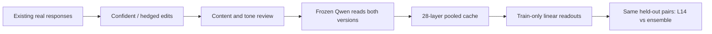

# Diverse paired certainty: measurement plan

Version 0.1, 11 October 2026. Extraction and primary readout choices are specified
before research scoring. **The final source split and held-out rewrite recipe
are not frozen yet. No held-out performance has been measured.**

## What we are testing

Can Qwen's internal states distinguish more certain from more hesitant
expressions of the same answer across new content and wording? Does combining
layers improve on a freshly fitted layer-14 readout on the same data?

The target is **expressed certainty about preserved answer content**. It is not
correctness, evidence support, semantic entropy, or a calibrated probability that
the answer is true. The earlier experiments remain independent diagnostics.
No language-model training, activation steering or SDT loss experiment is run.



## Data and review

The current pilot contains 50 development sources: 38 WildChat and 12 HelpSteer2.
Source authors, the GPT-6 Luna rewriter and the frozen Qwen representation model
have different roles. Qwen reads other models' text; these are not the source
authors' original activations.

Revision 2 changes only hesitant responses after the user's tone feedback.
The first packet is archived. All 50 remain pending individual content review;
general tone approval does not certify each pair. Automatic rules cannot replace
semantic review. Known errors in source answers are recorded, not silently fixed.

Actual exports from the local review page can be imported with
`src/import_reviews.py`. It checks the packet and response hashes and randomized
A/B mappings, retains the original export, and writes a separate reviewed file.
Only content-preserving, correctly ordered, unconfounded pairs pass individually.
The proposed pilot quality thresholds are 95% content preservation and 90%
clear certainty ordering after all 50 have been annotated. Passing them does not
automatically authorize a larger rewrite budget.

The planned main dataset is about 1,000 independent source groups, roughly
700/150/150 train/validation/test. All pilot sources and their derivatives stay
outside final test. Conversation, prompt and near-duplicate groups stay together.
New test content and a development-held-out rewrite recipe are required; their
identities and actual recipe text must be frozen before final scores are exposed.
With only one rewriter, recipe holdout is not cross-rewriter generalization.

## Exactly which hidden states

Input is the unchanged source user prompt and one written assistant response,
using Qwen's local chat template and a common system prompt. Qwen is not asked to
generate an answer. Labels, dataset names and rewrite instructions are absent
from the model input.

- **Primary:** mean of every ordinary assistant-response token state.
- **Auxiliary:** last ordinary assistant-response token, with its text and
  punctuation status recorded privately.
- **Negative control:** last prompt token; the prompt is identical within a pair.

Prompt, end-of-turn/EOS and padding tokens are excluded from response pooling
and NLL. Nothing is silently truncated. The input is capped at 1,024 tokens and
the response at 512. Batch size is 1 with a common right-padded length per pair.

Indices follow the installed Transformers Qwen2 API: `hidden_states[0]` is the
embedding state; indices 1–27 follow blocks 1–27; index 28 is the final block
state **after final RMSNorm**. This last index is not an unnormalized block
output. A tiny randomly initialized Qwen2 test compares API states with hooks
to verify this convention; production extraction uses the API, not hooks.

The pinned, unquantized local Qwen2.5-1.5B snapshot is
`989aa7980e4cf806f80c7fef2b1adb7bc71aa306`. Device preference is MPS, CUDA, CPU;
accelerators use FP16, CPU FP32. Cache keys include input IDs, per-pair padding,
full weight/tokenizer hashes, template hash, software versions, dtype/device,
layer convention and implementation hash. Only pooled FP16 states persist,
along with token IDs, masks, offsets and same-response NLL.

## Readout and comparison

For layer ℓ, fit the scaler on **training responses only**:

```math
z_\ell=(h_\ell-\mu_{\ell,\mathrm{train}})/\sigma_{\ell,\mathrm{train}},
\qquad d_{i,\ell}=z_{i,\ell}^{\mathrm{conf}}-z_{i,\ell}^{\mathrm{hedged}}.
```

Fit L2 paired logistic regression with mirrored rows `(d, 1)` and `(-d, 0)`,
each weighted 0.5, no intercept, `C=0.01` and at most 2,000 iterations.
Each source pair contributes total weight 1, not two independent observations.
Positive scores mean more confident expression; no test-data sign flips occur.

**M1:** the newly fitted layer-14 readout. **M2:** the equal average of all 28
layer scores, standardized using training-score means and standard deviations.
Near-zero score standard deviations contribute zero under the predeclared rule;
the denominator remains 28. Raw hidden vectors are not averaged across layers.

The implemented lightweight secondary baseline is a mean confident-minus-hedged
direction after training-feature scaling. It is not the frozen historical v1
direction. Source-grouped out-of-fold stacking is planned, not implemented;
in-sample stacking is not an acceptable substitute.

Main evaluation will use group-averaged pair ordering (`score(conf)>score(hedged)`,
ties 0.5), source-group bootstrap intervals and same-group differences between
M1/M2. The same train sources and locked natural test pairs will underpin the
template-versus-diverse 2×2 comparison. Learning curves and lexical, length,
NLL, shuffled-label and random-direction controls remain planned. Training-only
scaling and bootstrap utilities are tested on synthetic arrays now; the main
evaluation runner and final data have not been executed.

## Bounded engineering check

`src/run_preflight.py` selects 20 evenly spaced input-length ranks from the
current development packet, including shortest/longest inputs. It reads 40
responses once, checks identical-prompt states and additional right padding,
then requires an exact cache-only resume with zero model forwards.

This check is allowed while human review is pending. It does not fit a probe,
score final test, or certify the rewrites. Budget: 20 pairs, 20 minutes, batch 1,
10 GiB process RSS cap checked between forwards. A failure retains partial
caches and writes a failure record; it does not silently change precision or
device. Runtime estimates exclude rewriting, review and additional baselines.

After human review, the next decision is whether the content-preserving rewrite
protocol merits a separately budgeted expansion. Readout generalization and
eventual SDT usefulness remain separate, untested questions.
