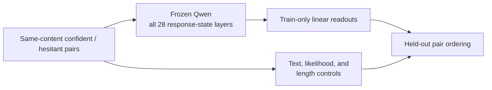

# Diverse Paired Certainty and Multi-Layer Readouts

## Bottom line

**A frozen layer-14 readout transferred to 47/50 new confident–hesitant pairs;
the fixed 28-layer ensemble reached 48/50.** On the same challenge, character
TF-IDF reached 34/50, answer likelihood 30/50, and response length 25/50. This
supports a transferable hidden-state signal for **expressed certainty about
preserved answer content** on this bounded task.

**The 100-source construction is mechanically complete, but the current pairs
are not activation-ready.** Local bidirectional chunk-NLI triage produced 506
judgments without truncation and flagged 14/100 pairs. A label-blind,
model-assisted review then examined all 14 flags and a task- and
dataset-balanced diagnostic sample of 10 unflagged pairs. Content was preserved
in 24/24 and a clear certainty contrast was judged in 24/24, but A/B direction
against the intended labels was not recorded or verified. Both versions were
clearly natural in only 5/24; the decisions were 5 accept, 4 discuss and 15
reject.

The review sample was diagnostic and nonrepresentative, so these counts do not
estimate the failure rate among all 100 pairs. It was not human certification.
The result is nevertheless sufficient to stop the current rendering before
hidden-state scoring: fixed global cue sentences disrupt several genres and
create placement shortcuts. No new probe score, SDT loss training, activation
steering, or causal test has been run on these 100 pairs.

**The v3.8 genre-aware canary also failed as main data before human review.**
It preserves one neutral base and changes only one or two minimal, detachable
certainty cues per pair. Across the 20 main pairs, there are 25 differing
Qwen-token positions, measured against 5,102 confident-side Qwen tokens
(0.49%). This is a cue-only shortcut control,
not the intended natural full-pair rewrite. Its frozen materials are preserved
for provenance, but human review of the v3.8 packets should not continue.

**The replacement direct-rewrite canary is now mechanically complete.** An
ordinary ChatGPT chat produced 50 full confident/hesitant pairs on the same
score-exposed challenge sources. The set retains the 5 × 5 × 2 grid and 25/25
length-direction balance; all 50 pass the mechanical and shortcut screens after
eighteen unique pairs received targeted full-pair regeneration. The project
researcher judged the blind packet broadly acceptable, and the recipe is
provisionally frozen while the next experiment is discussed with the advisor.
The exact executed Chat model slug was not exposed. This is provider and recipe
QA, not a new probe evaluation. See the
[construction report](../cue_holdout_challenge_v1/CHAT_PROVIDER_REPLICATION_50.md).

[Challenge result](../cue_holdout_challenge_v1/RESULTS.md) ·
[100-source checkpoint](reports/CHAT_CHECKPOINT_100.md) ·
[100-source review gate](reports/CHAT_CHECKPOINT_100_REVIEW_GATE.md) ·
[Data-construction gate](reports/DATA_CONSTRUCTION_GATE.md) ·
[Next decision](NEXT_DECISION.md)

## Research question

Can a frozen language model's internal states distinguish a confident response
from a hesitant response when both preserve the same answer content? Does an
equal all-layer ensemble improve on a simple layer-14 readout?

The target is deliberately narrow. It is not answer correctness, evidence
support, semantic entropy, subjective belief, or the probability that an answer
is true.

## Completed probe results

| Evaluation | Layer 14 | Equal 28-layer ensemble | Character TF-IDF | Answer likelihood | Length |
|---|---:|---:|---:|---:|---:|
| 50-pair development set | 50/50 | 50/50 | 50/50 | 49/50 | 47/50 |
| 50-pair cue/recipe-holdout challenge | **47/50** | **48/50** | 34/50 | 30/50 | 25/50 |

The development set was too easy: every hidden-state layer and the text
baseline were perfect. The separate challenge used new source groups, five
tasks, five held-out cue families, and exact 25/25 length counterbalancing. It
was evaluated once with the frozen readouts. The result is promising, but both
sets have model-assisted rather than human certification.

These values are paired ordering counts. They are not generated-answer
accuracy or calibrated confidence probabilities.

## How the readout works

Qwen2.5-1.5B is frozen and reads each supplied response. For every transformer
layer, the response-token hidden states are averaged. A linear paired readout is
fitted using training pairs only, with source-disjoint folds and train-only
standardization. Layer 14 is the primary readout; the equal average of all 28
layer scores is the prespecified ensemble.

The same held-out pairs are scored by text, likelihood, and length controls.
No response is generated by Qwen for the primary paired test, and no model
weights are updated.

## 100-source construction checkpoint

The ordinary-Chat expansion requested GPT-5.6, although the thread interface
did not expose an exact model slug. It used 75 WildChat and 25 HelpSteer sources
across five task groups, ten cue sets used ten times each, balanced pair order,
and balanced assignment of the longer response. All 100 records pass the final
mechanical rules after recorded repairs.

The [checkpoint report](reports/CHAT_CHECKPOINT_100.md) gives the complete
repair accounting, balance, transport notes, and reproducibility links. The
[review-gate report](reports/CHAT_CHECKPOINT_100_REVIEW_GATE.md) records the
NLI triage, label-blind diagnostic, limitations, and decision. The
[freeze manifest](manifests/gpt56_chat_neutral_100_v37_freeze.json) and
[text-free summary](manifests/gpt56_chat_neutral_100_v37_summary.json) record
the selected sources by hash and the final counts.

## Earlier data-construction development

The first expansion recipes exposed several failure modes: verbatim source
copying, early or formulaic hesitation cues, object-level meaning changes, and
length confounds. The historical shared-base construction asked Claude for one
neutral, content-preserving paraphrase, then used an auditable local cue bank to
produce the confident and hesitant versions. It is no longer the main-data
method because the two members differ too locally.

| Development version | Main result | Use |
|---|---|---|
| v3.3 | 1 direct retain, 14 repairs, 5 discards out of 20 | Rejected |
| v3.4 | 2 direct retains, 8 repairs out of 10 | Revised |
| v3.5 | 10/10 mechanical and semantic passes after repair | Historical construction gate |
| v3.6 | 0/10 paraphrase-gate passes; only 0–3.6% neutral edits | **Lexical-control data only** |
| v3.7 | 10/10 mechanical and final semantic passes after repair | Historical construction gate; later rejected as a main recipe |

These were sequential development iterations, not an unbiased benchmark. See
the [canonical construction report](reports/DATA_CONSTRUCTION_GATE.md) for the
exact source-review counts, initial and repaired results, and decision boundary.

## Next step

1. Keep v3.8 only as a frozen cue-only diagnostic/control.
2. Record the single-researcher judgment as broadly acceptable, not as
   independent human certification.
3. Pause for advisor review of the evidence and proposed fresh test.
4. If continuation is agreed, apply the provisionally frozen recipe to fresh,
   unscored sources and repeat the complete mechanical and human review gates.
5. Then freeze the cue-only baseline and leave-one-cue-family-out test, extract
   every layer once, and compare layer 14, all individual layers, and the fixed
   equal-layer ensemble.
6. Expand to 300 and 700 sources only if the fresh unscored result
   justifies it.

The v3.8 packet remains useful because it isolates the easiest possible lexical
cue condition. It cannot support a claim about a natural confidence-related
representation, regardless of whether its individual sentences sound fluent.

The locked 50-pair challenge is already score-exposed and must not be edited or
tuned against. No 1,000-pair generation, SDT loss training, activation steering,
or causal claim is authorized in this phase.

All source text, rewritten responses, reviewer output, and unblinding material
remain under ignored `private_data/`.

## Repository map

| Material | Location |
|---|---|
| Challenge result | [../cue_holdout_challenge_v1/RESULTS.md](../cue_holdout_challenge_v1/RESULTS.md) |
| Development result | [reports/DEVELOPMENT_DIAGNOSTIC.md](reports/DEVELOPMENT_DIAGNOSTIC.md) |
| Data-construction decision | [reports/DATA_CONSTRUCTION_GATE.md](reports/DATA_CONSTRUCTION_GATE.md) |
| 100-source construction checkpoint | [reports/CHAT_CHECKPOINT_100.md](reports/CHAT_CHECKPOINT_100.md) |
| 100-source review gate | [reports/CHAT_CHECKPOINT_100_REVIEW_GATE.md](reports/CHAT_CHECKPOINT_100_REVIEW_GATE.md) |
| Frozen v3.8 cue-only diagnostic and provenance | [V38_GENRE_AWARE_CANARY.md](V38_GENRE_AWARE_CANARY.md) |
| 50-pair direct-rewrite construction report | [../cue_holdout_challenge_v1/CHAT_PROVIDER_REPLICATION_50.md](../cue_holdout_challenge_v1/CHAT_PROVIDER_REPLICATION_50.md) |
| Current status | [STATUS.md](STATUS.md) |
| Next decision | [NEXT_DECISION.md](NEXT_DECISION.md) |
| Research definition and method | [PROTOCOL.md](PROTOCOL.md) |
| Historical challenge design | [NEXT_CHALLENGE.md](NEXT_CHALLENGE.md) |
| Rewrite contract and resource record | [REWRITE_SPEC.md](REWRITE_SPEC.md) / [REWRITE_BUDGET.md](REWRITE_BUDGET.md) |
| Historical Gemini smoke | [GEMINI_REWRITE_SMOKE.md](GEMINI_REWRITE_SMOKE.md) |
| Machine-readable results | [results/](results/) |
| Public code and tests | [src/](src/) / [tests/](tests/) |

Third-party response bodies, rewrites, and reviewer files remain in ignored
local storage. Public files contain code, configurations, aggregate results,
hashes, and decision records only. Historical negative results are retained as
evidence rather than silently replaced.
