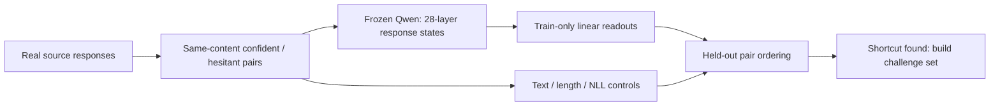

# Diverse paired certainty and multi-layer readouts

> **Follow-up completed:** the independent cue/recipe-holdout challenge reached
> **47/50 at layer 14 and 48/50 with the fixed ensemble**, versus 34/50 for
> character TF-IDF, 30/50 for answer likelihood and 25/50 for length. Read the
> [current result](../cue_holdout_challenge_v1/RESULTS.md). The development
> findings below are retained as the reason that challenge was necessary. The
> [next decision](NEXT_DECISION.md) records the unfinished handoff scope.

## Conclusion first

**On the 50-pair development set, layer 14 and the equal 28-layer ensemble both
ranked every confident response above its hesitant counterpart. The ensemble did
not improve on layer 14.**

This does not yet validate a general confidence representation. Character TF-IDF
also scored 50/50, negative mean NLL scored 49/50, and response length scored
47/50. Every hidden-state layer scored 50/50. The current rewrites validate the
pipeline, but are too easy to separate internal confidence from wording and
length shortcuts.

**Decision at this stage:** do not scale this recipe or train an SDT confidence
loss before an independent, length-counterbalanced challenge. That follow-up is
now complete; see the link above. This section records the earlier development
decision and [development report](reports/DEVELOPMENT_DIAGNOSTIC.md).

## Research question and method

Can a frozen language model's hidden states distinguish more certain from more
hesitant expressions of the same answer across new content and wording? Does a
simple all-layer ensemble improve on layer 14?

The label is **expressed certainty about preserved answer content**. It is not
answer correctness, evidence support, semantic entropy, or a probability that
the answer is true.

- 50 real-source responses from WildChat and HelpSteer2 across five task types.
- Agent-assisted QA and targeted correction of 10 pairs; all 50 passed the final
  agent check. Individual human review remains pending.
- Frozen, local Qwen2.5-1.5B reads each supplied response; it does not generate
  answers in this experiment.
- Response-token mean states from all 28 layers, plus last-token and prompt
  controls.
- Five task-stratified, source-disjoint folds. Every transform is fitted on the
  training folds only.
- The same held-out pairs are scored by layer 14, an equal-layer ensemble,
  character TF-IDF, mean NLL, response length and shuffled-label controls.



## Key results

| Method | Held-out pair ordering |
|---|---:|
| Layer 14 | **50/50** |
| Equal 28-layer ensemble | **50/50** |
| Character TF-IDF | **50/50** |
| Negative mean NLL | **49/50** |
| Negative response length | **47/50** |


These are development-set ordering counts, not generated-answer accuracy or
confidence probabilities. The `[1,1]` bootstrap intervals in the result file
are degenerate because all 50 observed pairs were successes; they do not imply
perfect performance on future data.

## Where to look

| Material | Location |
|---|---|
| Result and interpretation | [reports/DEVELOPMENT_DIAGNOSTIC.md](reports/DEVELOPMENT_DIAGNOSTIC.md) |
| Research definition and exact method | [PROTOCOL.md](PROTOCOL.md) |
| Current progress and next action | [STATUS.md](STATUS.md) |
| Completed challenge design | [NEXT_CHALLENGE.md](NEXT_CHALLENGE.md) |
| Current next decision | [NEXT_DECISION.md](NEXT_DECISION.md) |
| Rewriter contract / resource record | [REWRITE_SPEC.md](REWRITE_SPEC.md) / [REWRITE_BUDGET.md](REWRITE_BUDGET.md) |
| Pinned source identities, coverage and draft checks | [manifests/](manifests/) |
| All-layer configuration | [configs/diverse_pairs_multilayer_v1.yaml](configs/diverse_pairs_multilayer_v1.yaml) |
| Machine-readable diagnostic | [results/DEVELOPMENT_DIAGNOSTIC.json](results/DEVELOPMENT_DIAGNOSTIC.json) |
| 20-pair expansion canary audit | [reports/claude_canary_20_audit.json](reports/claude_canary_20_audit.json) |
| Gemini/Antigravity rewrite smoke | [GEMINI_REWRITE_SMOKE.md](GEMINI_REWRITE_SMOKE.md) |
| Layer figure | [results/DEVELOPMENT_LAYER_COMPARISON.png](results/DEVELOPMENT_LAYER_COMPARISON.png) |
| Engineering checks | [results/EXTRACTION_SANITY.json](results/EXTRACTION_SANITY.json) |
| Extraction, readouts and review importer | [src/](src/) |
| Regression and synthetic-data checks | [tests/](tests/) |
| Original/rewritten text and actual annotations | `private_data/`, local and ignored |
| Token IDs and pooled hidden states | `cache/`, local and ignored |

Third-party response bodies and rewrites are not published. Public files contain
aggregate results, source counts and code only. Historical experiments and
negative diagnostics remain unchanged elsewhere in the repository.

## Next step

The independent 50-pair challenge is complete and now score-exposed. Do not
rewrite it or tune against it. Obtain human blind review, then complete the
handoff's matched diverse-versus-template comparison and 100/300/700-source
learning curves on one separately locked natural test set. Layer 14 remains the
primary readout and the equal 28-layer score the prespecified ensemble. See
[NEXT_DECISION.md](NEXT_DECISION.md). This expansion does not authorize SDT
training.

### 1,000-source expansion: stopped after the first canary

The later Antigravity/Gemini transport pilot also **did not authorize scale**:
the strict frozen gate passed 0/8, and agent-assisted semantic review found two
clear content-preservation failures. See the concise
[Gemini rewrite smoke report](GEMINI_REWRITE_SMOKE.md). These are failures of
the current generation method, not activation-probe results.

The source pool is frozen: 1,000 main sources plus 200 split-matched reserves,
with a 750/250 WildChat–HelpSteer2 mixture and a fixed 700/150/150
train/validation/test split. The earlier 50-pair development set and 50-pair
challenge are excluded.

The first 20-pair Claude canary **did not authorize scaling**. Six pairs passed
the strict runner and 14 failed only the pair-length controls. More importantly,
the independent audit found that 19/20 confident responses copied the source
response verbatim, while the hesitant edit appeared near the beginning in
16/20 pairs. Blind agent review found a clear certainty ordering in 20/20, but
content preservation in 19/20 and correct speaker scope in 16/20. This contract
would risk teaching a readout to detect an added hesitation cue rather than a
broader confidence-related representation.

The remaining 980 calls were stopped. The next action is a fresh 20-pair canary
that requires both members to be genuine matched rewrites, counterbalances the
position of the confidence-bearing edit, and uses a word-count instruction that
Claude can execute while Qwen-token length remains an external check. See the
text-free [aggregate canary audit](reports/claude_canary_20_audit.json).

A separate, resumable Claude Code runner is now prepared for the planned
1,000-source diverse-rewrite expansion. It uses the user's authenticated Claude
subscription rather than an Anthropic API key, fixes the model to
`claude-sonnet-4-6` at low effort, isolates every 20-source call without tools,
plugins, MCP servers, Chrome access or session persistence, and validates the
frozen input and every returned pair. A bounded first 20-source call completed,
but the original v1 parser conservatively rejected its otherwise complete raw
response because Claude Code reported both the requested Sonnet model and a
15-output-token internal Haiku helper. The immutable v1 raw response, failure
record and run manifest remain in `private_data/claude_rewrite_1000/`; no later
batch has been generated. That response was subsequently recovered and audited
locally with zero additional Claude calls; it failed the quality gate described
above. Execution fails closed unless
`claude auth status --json` reports `loggedIn=true`, `authMethod=claude.ai`, and
`apiProvider=firstParty` in the same allowlisted, provider-credential-free
environment used for generation. Outputs are restricted to this experiment's
ignored `private_data/` tree.

Resume safety is content-addressed: source bytes and order, source prompt and
response content, rewrite order and length assignment, protocol, runner source,
model/effort, system prompt, recipe instructions, structured schema and pinned
Qwen validation settings all contribute to one generation fingerprint. Every
raw attempt is immutable and a successfully saved raw response can be recovered
without another model call. A mismatched prior artifact stops the run rather
than being silently reused. Valid pairs must stay within 512 response tokens and
1,024 full-chat tokens under the pinned local Qwen tokenizer, obey the assigned
longer side with a gap of at most three tokens, and have no untriaged writer
issue. `not_applicable` requires a written reason. Transport, auth, Claude error
envelopes and structured-output processing failures produce a nonzero exit.
The v2 parser requires the requested Sonnet model to produce positive output,
allows only the exact internal helper model `claude-haiku-4-5-20251001`, and
caps helper output at both 64 tokens and 1% of all reported model output. Any
other model, malformed usage, larger helper output or usage inconsistency is a
processing failure.

### Canary v1-to-v2 recovery checklist

The production config now writes only to
`private_data/claude_rewrite_1000_v2/`. Do not delete, rename or resume the v1
namespace. Recover the completed first response locally with the command below;
`--recover-only` is mutually exclusive with `--execute`, skips authentication,
and contains no Claude subprocess path:

```sh
python experiments/diverse_pairs_multilayer_v1/src/run_claude_rewrite_batches.py \
  --recover-only \
  --recover-from-output-dir experiments/diverse_pairs_multilayer_v1/private_data/claude_rewrite_1000 \
  --max-batches 1
```

Recovery first verifies the old run contract, exact raw/manifest hashes, batch
identity, prompt hash and original Claude command. It then revalidates the saved
stdout under v2 and writes only a new parsed artifact with both fingerprints and
the old raw, failure-record and manifest hashes. It never copies or modifies v1
and records `additional_claude_calls: 0`. Confirm 20 terminal records and perform
the separate canary quality review before authorizing any additional call. The
fixed resume logic preserves the original batch boundaries; a partial cached
batch now fails closed.

## Reproduce locally

Use the existing project environment and already cached pinned Qwen snapshot.
Source-pool settings are in YAML and Claude-run settings are in the dedicated
JSON config; validation never downloads a model.

```sh
python experiments/diverse_pairs_multilayer_v1/src/run_development_diagnostic.py
python -m pytest tests experiments/diverse_pairs_multilayer_v1/tests -q
# After the 1,000-source pool is frozen, validate and print the Claude batch plan:
python experiments/diverse_pairs_multilayer_v1/src/run_claude_rewrite_batches.py
# Only after local recovery and canary review, a new bounded generation requires
# explicit authorization and --execute. It resumes after the recovered batch.
python experiments/diverse_pairs_multilayer_v1/src/run_claude_rewrite_batches.py --execute --max-batches 1
```

The diagnostic needs the ignored local pair packet and refuses to run unless all
50 current pairs pass the agent-QA gate. This gate remains separate from human
review. Activations are content-addressed and resumable; the final verification
replayed all 100 response caches with zero model forwards.
