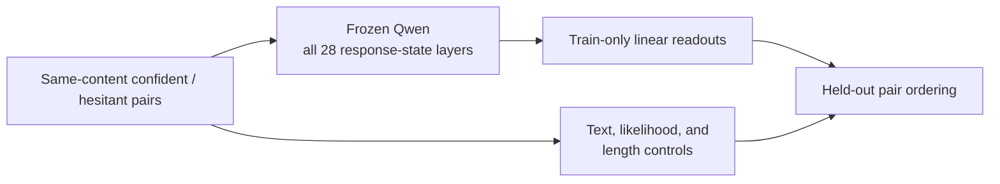
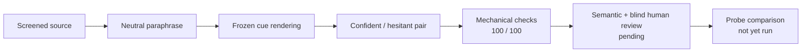

# Diverse Paired Certainty and Multi-Layer Readouts

## Bottom line

**A frozen layer-14 readout transferred to 47/50 new confident–hesitant pairs;
the fixed 28-layer ensemble reached 48/50.** On the same challenge, character
TF-IDF reached 34/50, answer likelihood 30/50, and response length 25/50. This
supports a transferable hidden-state signal for **expressed certainty about
preserved answer content** on this bounded task.

**A 100-source construction checkpoint now passes all final mechanical checks.**
Eighty-one records required no recorded repair; 19 required at least one repair,
with 12 model-regenerated templates, eight local template repairs, and one
record receiving both. Five unsuitable sources were replaced within the same
sampling strata before the set was finalized.

This checkpoint does not strengthen the probe result by itself. Independent
semantic review and blind human review are still pending, so the 100 pairs are
not validated training data. No new probe score, SDT loss training, activation
steering, or causal test has been run on them.

[Challenge result](../cue_holdout_challenge_v1/RESULTS.md) ·
[100-source checkpoint](reports/CHAT_CHECKPOINT_100.md) ·
[Data-construction gate](reports/DATA_CONSTRUCTION_GATE.md) ·
[Next decision](NEXT_DECISION.md)

## Research question

Can a frozen language model's internal states distinguish a confident response
from a hesitant response when both preserve the same answer content? Does an
equal all-layer ensemble improve on a simple layer-14 readout?

The target is deliberately narrow. It is not answer correctness, evidence
support, semantic entropy, subjective belief, or the probability that an answer
is true.

## Completed probe results

| Evaluation | Layer 14 | Equal 28-layer ensemble | Character TF-IDF | Answer likelihood | Length |
|---|---:|---:|---:|---:|---:|
| 50-pair development set | 50/50 | 50/50 | 50/50 | 49/50 | 47/50 |
| 50-pair cue/recipe-holdout challenge | **47/50** | **48/50** | 34/50 | 30/50 | 25/50 |

The development set was too easy: every hidden-state layer and the text
baseline were perfect. The separate challenge used new source groups, five
tasks, five held-out cue families, and exact 25/25 length counterbalancing. It
was evaluated once with the frozen readouts. The result is promising, but both
sets have model-assisted rather than human certification.

These values are paired ordering counts. They are not generated-answer
accuracy or calibrated confidence probabilities.

## How the readout works

Qwen2.5-1.5B is frozen and reads each supplied response. For every transformer
layer, the response-token hidden states are averaged. A linear paired readout is
fitted using training pairs only, with source-disjoint folds and train-only
standardization. Layer 14 is the primary readout; the equal average of all 28
layer scores is the prespecified ensemble.

The same held-out pairs are scored by text, likelihood, and length controls.
No response is generated by Qwen for the primary paired test, and no model
weights are updated.

## 100-source construction checkpoint

The ordinary-Chat expansion requested GPT-5.6, although the thread interface
did not expose an exact model slug. It used 75 WildChat and 25 HelpSteer sources
across five task groups, ten cue sets used ten times each, balanced pair order,
and balanced assignment of the longer response. All 100 records pass the final
mechanical rules after recorded repairs.

The [checkpoint report](reports/CHAT_CHECKPOINT_100.md) gives the complete
repair accounting, balance, transport notes, and reproducibility links. The
[freeze manifest](manifests/gpt56_chat_neutral_100_v37_freeze.json) and
[text-free summary](manifests/gpt56_chat_neutral_100_v37_summary.json) record
the selected sources by hash and the final counts.

## Earlier data-construction development

The first expansion recipes exposed several failure modes: verbatim source
copying, early or formulaic hesitation cues, object-level meaning changes, and
length confounds. The current two-stage method asks Claude for one neutral,
content-preserving paraphrase, then uses an auditable local cue bank to produce
the confident and hesitant versions.

| Development version | Main result | Use |
|---|---|---|
| v3.3 | 1 direct retain, 14 repairs, 5 discards out of 20 | Rejected |
| v3.4 | 2 direct retains, 8 repairs out of 10 | Revised |
| v3.5 | 10/10 mechanical and semantic passes after repair | First retained canary |
| v3.6 | 0/10 paraphrase-gate passes; only 0–3.6% neutral edits | **Lexical-control data only** |
| v3.7 | 10/10 mechanical and final semantic passes after repair | Second retained canary; candidate main recipe |

These were sequential development iterations, not an unbiased benchmark. See
the [canonical construction report](reports/DATA_CONSTRUCTION_GATE.md) for the
exact source-review counts, initial and repaired results, and decision boundary.

## Next step

1. Run an independent semantic audit and blind human review of the 100-source
   checkpoint.
2. Freeze a matched cue-only baseline and a leave-one-cue-family-out test.
3. If those gates pass, extract and cache every layer once; compare layer 14,
   every individual layer, and the fixed equal-layer ensemble.
4. Expand to 300 and 700 sources only if the 100-source results justify it.

The locked 50-pair challenge is already score-exposed and must not be edited or
tuned against. No 1,000-pair generation, SDT loss training, activation steering,
or causal claim is authorized in this phase.

All source text, rewritten responses, reviewer output, and unblinding material
remain under ignored `private_data/`.

## Repository map

| Material | Location |
|---|---|
| Challenge result | [../cue_holdout_challenge_v1/RESULTS.md](../cue_holdout_challenge_v1/RESULTS.md) |
| Development result | [reports/DEVELOPMENT_DIAGNOSTIC.md](reports/DEVELOPMENT_DIAGNOSTIC.md) |
| Data-construction decision | [reports/DATA_CONSTRUCTION_GATE.md](reports/DATA_CONSTRUCTION_GATE.md) |
| 100-source construction checkpoint | [reports/CHAT_CHECKPOINT_100.md](reports/CHAT_CHECKPOINT_100.md) |
| Current status | [STATUS.md](STATUS.md) |
| Next decision | [NEXT_DECISION.md](NEXT_DECISION.md) |
| Research definition and method | [PROTOCOL.md](PROTOCOL.md) |
| Historical challenge design | [NEXT_CHALLENGE.md](NEXT_CHALLENGE.md) |
| Rewrite contract and resource record | [REWRITE_SPEC.md](REWRITE_SPEC.md) / [REWRITE_BUDGET.md](REWRITE_BUDGET.md) |
| Historical Gemini smoke | [GEMINI_REWRITE_SMOKE.md](GEMINI_REWRITE_SMOKE.md) |
| Machine-readable results | [results/](results/) |
| Public code and tests | [src/](src/) / [tests/](tests/) |

Third-party response bodies, rewrites, and reviewer files remain in ignored
local storage. Public files contain code, configurations, aggregate results,
hashes, and decision records only. Historical negative results are retained as
evidence rather than silently replaced.
