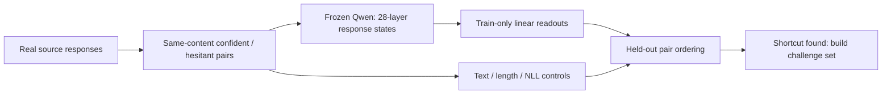

# Diverse paired certainty and multi-layer readouts

## Conclusion first

**On the 50-pair development set, layer 14 and the equal 28-layer ensemble both
ranked every confident response above its hesitant counterpart. The ensemble did
not improve on layer 14.**

This does not yet validate a general confidence representation. Character TF-IDF
also scored 50/50, negative mean NLL scored 49/50, and response length scored
47/50. Every hidden-state layer scored 50/50. The current rewrites validate the
pipeline, but are too easy to separate internal confidence from wording and
length shortcuts.

**Decision:** do not scale this recipe or train an SDT confidence loss. First
build a small, independent, length-counterbalanced challenge set with held-out
certainty wording. See the [development report](reports/DEVELOPMENT_DIAGNOSTIC.md).

## Research question and method

Can a frozen language model's hidden states distinguish more certain from more
hesitant expressions of the same answer across new content and wording? Does a
simple all-layer ensemble improve on layer 14?

The label is **expressed certainty about preserved answer content**. It is not
answer correctness, evidence support, semantic entropy, or a probability that
the answer is true.

- 50 real-source responses from WildChat and HelpSteer2 across five task types.
- Agent-assisted QA and targeted correction of 10 pairs; all 50 passed the final
  agent check. Individual human review remains pending.
- Frozen, local Qwen2.5-1.5B reads each supplied response; it does not generate
  answers in this experiment.
- Response-token mean states from all 28 layers, plus last-token and prompt
  controls.
- Five task-stratified, source-disjoint folds. Every transform is fitted on the
  training folds only.
- The same held-out pairs are scored by layer 14, an equal-layer ensemble,
  character TF-IDF, mean NLL, response length and shuffled-label controls.



## Key results

| Method | Held-out pair ordering |
|---|---:|
| Layer 14 | **50/50** |
| Equal 28-layer ensemble | **50/50** |
| Character TF-IDF | **50/50** |
| Negative mean NLL | **49/50** |
| Negative response length | **47/50** |


These are development-set ordering counts, not generated-answer accuracy or
confidence probabilities. The `[1,1]` bootstrap intervals in the result file
are degenerate because all 50 observed pairs were successes; they do not imply
perfect performance on future data.

## Where to look

| Material | Location |
|---|---|
| Result and interpretation | [reports/DEVELOPMENT_DIAGNOSTIC.md](reports/DEVELOPMENT_DIAGNOSTIC.md) |
| Research definition and exact method | [PROTOCOL.md](PROTOCOL.md) |
| Current progress and next action | [STATUS.md](STATUS.md) |
| Frozen next challenge | [NEXT_CHALLENGE.md](NEXT_CHALLENGE.md) |
| Rewriter contract / resource record | [REWRITE_SPEC.md](REWRITE_SPEC.md) / [REWRITE_BUDGET.md](REWRITE_BUDGET.md) |
| Pinned source identities, coverage and draft checks | [manifests/](manifests/) |
| All-layer configuration | [configs/diverse_pairs_multilayer_v1.yaml](configs/diverse_pairs_multilayer_v1.yaml) |
| Machine-readable diagnostic | [results/DEVELOPMENT_DIAGNOSTIC.json](results/DEVELOPMENT_DIAGNOSTIC.json) |
| Layer figure | [results/DEVELOPMENT_LAYER_COMPARISON.png](results/DEVELOPMENT_LAYER_COMPARISON.png) |
| Engineering checks | [results/EXTRACTION_SANITY.json](results/EXTRACTION_SANITY.json) |
| Extraction, readouts and review importer | [src/](src/) |
| Regression and synthetic-data checks | [tests/](tests/) |
| Original/rewritten text and actual annotations | `private_data/`, local and ignored |
| Token IDs and pooled hidden states | `cache/`, local and ignored |

Third-party response bodies and rewrites are not published. Public files contain
aggregate results, source counts and code only. Historical experiments and
negative diagnostics remain unchanged elsewhere in the repository.

## Next step

Build about 50 new challenge pairs from unseen source groups and rewrite recipes.
Counterbalance which response is longer, hold out certainty-cue families, add
compositional cue cases, and obtain blinded content/tone review. Freeze layer 14,
the ensemble and all surface baselines before scoring. Passing that test would
justify expansion; it would still not by itself validate evidence-sensitive
confidence or authorize SDT training.

## Reproduce locally

Use the existing project environment and already cached pinned Qwen snapshot.
Paths and limits are in the YAML; there are no model downloads or inference APIs.

```sh
python experiments/diverse_pairs_multilayer_v1/src/run_development_diagnostic.py
python -m pytest tests experiments/diverse_pairs_multilayer_v1/tests -q
```

The diagnostic needs the ignored local pair packet and refuses to run unless all
50 current pairs pass the agent-QA gate. This gate remains separate from human
review. Activations are content-addressed and resumable; the final verification
replayed all 100 response caches with zero model forwards.
