# 100-Source Ordinary-Chat Construction Checkpoint

## Conclusion

**The probe result remains positive: the frozen layer-14 readout ranked 47/50
new confident–hesitant pairs correctly, and the fixed 28-layer ensemble ranked
48/50.** That is the current evidence that expressed certainty is recoverable
from hidden states beyond the tested text, likelihood, and length controls.

**The new 100-source checkpoint completed mechanical validation for all 100
records, but the current rendering did not pass the subsequent review gate.**
A label-blind, model-assisted diagnostic found preserved content and a clear
certainty contrast in 24/24 selected cases, but it did not record or verify A/B
direction against the intended labels. Both versions were clearly natural in
only 5/24. Fixed global cue sentences created placement and genre confounds.

This is not a new probe result. The reviewed cases were deliberately diagnostic
and nonrepresentative, and the review was not human certification. The pairs
are **not validated training data**. No hidden states were extracted, no probe
was fitted or scored, and no loss training was run on this checkpoint.

## What was constructed

One neutral, content-preserving paraphrase was requested for each source through
an ordinary Chat session. The requested model family was GPT-5.6; the interface
did not expose an exact model slug. A frozen local cue bank then rendered a
confident and a hesitant response from the same neutral content.

Source selection used automated screening only. No source-level human
certification has been completed; the later diagnostic was model-assisted and
does not change that status.

```mermaid
flowchart LR
    A["100 screened source responses"] --> B["Neutral content-preserving<br/>paraphrase"]
    B --> C["Frozen local cue bank"]
    C --> D["Confident / hesitant<br/>same-content pair"]
    D --> E["Mechanical validation<br/>100 / 100 final pass"]
    E --> F["Local NLI triage<br/>506 judgments"]
    F --> G["Label-blind diagnostic<br/>24 selected pairs"]
    G --> H["Naturalness / placement<br/>gate did not pass"]
    H --> I["Genre-aware 20-pair<br/>canary next"]
```

## Checkpoint accounting

| Item | Count |
|---|---:|
| Final records passing all mechanical checks | **100/100** |
| Records without a recorded repair | 81 |
| Model-regenerated templates | 12 |
| Local template repairs | 8 |
| Unique records repaired | 19 |
| Records receiving both repair types | 1 |
| Same-stratum source-pool replacements | 5 |

The 12 model regenerations and eight local repairs are 20 repair actions across
19 unique records. Five of the model-regenerated records also used a
source-pool replacement; these are not five additional repaired records. They
replace sources that could not support a meaningful paraphrase under the frozen
rules while preserving the assigned dataset, task, length, target, and rewrite
strata.

## Frozen balance

| Dimension | Distribution |
|---|---|
| Source datasets | 75 WildChat / 25 HelpSteer |
| Task groups | 19 comparison, 34 factual, 16 math, 13 programming, 18 summary |
| Cue sets | 10 sets × 10 records |
| Pair output order | 50 confident-first / 50 hesitant-first |
| Longer member | 50 confident / 50 hesitant |

These controls remove several easy construction imbalances, but they do not
establish semantic equivalence or rule out subtler wording shortcuts.

## Review-gate result

Local `cross-encoder/nli-deberta-v3-small` triage compared source and neutral
template chunks in both directions. It made 506 judgments, observed a maximum
of 440 tokens against the model's 512-token limit, used no truncation, and
flagged 14/100 pairs. These are screening flags, not semantic certificates.

A label-blind, model-assisted reviewer then examined all 14 flags plus a task-
and dataset-balanced diagnostic sample of 10 unflagged pairs.

| Criterion | Result |
|---|---:|
| Answer content preserved | **24/24** |
| Clear certainty contrast judged | **24/24** |
| A/B direction matched to intended labels | Not recorded or verified |
| Both versions clearly natural | **5/24** |
| Cue applies to the full response | 22/24 |
| Accept / discuss / reject | **5 / 4 / 15** |

The flagged group split 2/3/9 across accept/discuss/reject, and the unflagged
sample split 3/1/6. Because the diagnostic intentionally included every NLI
flag, it is **not a population failure-rate estimate**. Because the reviewer
was model-assisted, it is also **not human certification**.

The dominant failure was genre-inappropriate cue placement. Fixed global cue
sentences disrupted lists, tables, dialogue, code and worked examples,
strict-format or length-constrained responses, and genres where “conclusion”
language was unnatural. The [review-gate report](CHAT_CHECKPOINT_100_REVIEW_GATE.md)
records the full aggregate result and limitations.

## Transport notes

Generation was sent in ten-record transport chunks and assembled into five
twenty-record logical batches. One initial twenty-record response exceeded the
thread read limit and was re-emitted in groups of ten. One stale-ID response was
rejected rather than merged and then retried. Both events are recorded in the
public manifests.

## Decision

The checkpoint is mechanically complete, but the current rendering is not
ready for activation scoring or model training.

1. Retain the neutral templates and define source eligibility plus genre-aware
   cue placement.
2. Build a 20-pair canary spanning the affected genres and review all 20
   blindly.
3. Only if the canary passes, repair and re-render the 100 pairs and repeat the
   full review gate.
4. Then freeze the cue-only and leave-one-cue-family-out controls, extract all
   layers once, and compare layer 14, every layer, and the fixed ensemble.
5. Treat expansion to 300 and 700 sources as conditional on the repaired
   100-source result.

## Reproducibility record

- [Frozen selection and balance manifest](../manifests/gpt56_chat_neutral_100_v37_freeze.json)
- [Text-free final summary and hashes](../manifests/gpt56_chat_neutral_100_v37_summary.json)
- [Configuration](../configs/gpt56_chat_neutral_100_v37.json)
- [Construction and validation script](../src/gpt_chat_neutral_checkpoint.py)
- [Tests](../tests/test_gpt_chat_neutral_checkpoint.py)
- [Review-gate report](CHAT_CHECKPOINT_100_REVIEW_GATE.md)
- [NLI triage configuration](../configs/local_nli_semantic_triage_chat_100_v37.json)
- [Public NLI triage output](CHAT_CHECKPOINT_100_NLI_TRIAGE.json)
- [Blind-review configuration](../configs/blind_human_review_chat_100_v37.json)
- [Public agent-diagnostic aggregate](CHAT_CHECKPOINT_100_AGENT_DIAGNOSTIC.json)

Source responses, paraphrases, rendered pairs, and repair records remain in
ignored local storage. Public artifacts contain only aggregate counts, hashes,
configuration, and code.
