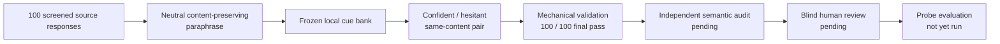

# 100-Source Ordinary-Chat Construction Checkpoint

## Conclusion

**The probe result remains positive: the frozen layer-14 readout ranked 47/50
new confident–hesitant pairs correctly, and the fixed 28-layer ensemble ranked
48/50.** That is the current evidence that expressed certainty is recoverable
from hidden states beyond the tested text, likelihood, and length controls.

**The new 100-source checkpoint completed mechanical validation for all 100
records.** It tests whether the proposed pair-construction workflow can operate
at a useful development scale while preserving its frozen balancing rules.

This is not a new probe result. Independent semantic review and blind human
review are still pending, so these pairs are **not validated training data**.
No hidden states were extracted, no probe was fitted or scored, and no loss
training was run on this checkpoint.

## What was constructed

One neutral, content-preserving paraphrase was requested for each source through
an ordinary Chat session. The requested model family was GPT-5.6; the interface
did not expose an exact model slug. A frozen local cue bank then rendered a
confident and a hesitant response from the same neutral content.

Source selection used automated screening only. Source-level human review is
part of the pending review gate rather than a completed property of this set.

## Checkpoint accounting

| Item | Count |
|---|---:|
| Final records passing all mechanical checks | **100/100** |
| Records without a recorded repair | 81 |
| Model-regenerated templates | 12 |
| Local template repairs | 8 |
| Unique records repaired | 19 |
| Records receiving both repair types | 1 |
| Same-stratum source-pool replacements | 5 |

The 12 model regenerations and eight local repairs are 20 repair actions across
19 unique records. Five of the model-regenerated records also used a
source-pool replacement; these are not five additional repaired records. They
replace sources that could not support a meaningful paraphrase under the frozen
rules while preserving the assigned dataset, task, length, target, and rewrite
strata.

## Frozen balance

| Dimension | Distribution |
|---|---|
| Source datasets | 75 WildChat / 25 HelpSteer |
| Task groups | 19 comparison, 34 factual, 16 math, 13 programming, 18 summary |
| Cue sets | 10 sets × 10 records |
| Pair output order | 50 confident-first / 50 hesitant-first |
| Longer member | 50 confident / 50 hesitant |

These controls remove several easy construction imbalances, but they do not
establish semantic equivalence or rule out subtler wording shortcuts.

## Transport notes

Generation was sent in ten-record transport chunks and assembled into five
twenty-record logical batches. One initial twenty-record response exceeded the
thread read limit and was re-emitted in groups of ten. One stale-ID response was
rejected rather than merged and then retried. Both events are recorded in the
public manifests.

## Decision

The checkpoint is sufficient to move to review, not to model training.

1. Run an independent semantic audit and a label-blind human review.
2. Freeze the cue-only baseline and leave-one-cue-family-out controls.
3. Only if those checks support the construction, extract and cache all layers
   once, then compare layer 14, every individual layer, and the fixed ensemble.
4. Treat expansion to 300 and 700 sources as conditional on those results.

## Reproducibility record

- [Frozen selection and balance manifest](../manifests/gpt56_chat_neutral_100_v37_freeze.json)
- [Text-free final summary and hashes](../manifests/gpt56_chat_neutral_100_v37_summary.json)
- [Configuration](../configs/gpt56_chat_neutral_100_v37.json)
- [Construction and validation script](../src/gpt_chat_neutral_checkpoint.py)
- [Tests](../tests/test_gpt_chat_neutral_checkpoint.py)

Source responses, paraphrases, rendered pairs, and repair records remain in
ignored local storage. Public artifacts contain only aggregate counts, hashes,
configuration, and code.
