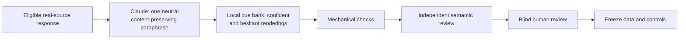

# Data Construction Gate

## Conclusion

**The two-stage rewrite method passed both the mechanical and independent
model-assisted semantic gates after small, recorded local repairs. Across the
two retained canaries, 20/20 pairs now pass both checks. The method is ready for
blind human review, not yet for automatic large-scale generation.**

The source screen retained **74 of 200 candidates (37%)** for rewrite
development. Of the remainder, 110 were rejected and 16 require human review.
This confirms that deterministic filters alone are not enough to build a
reliable source pool.

The latest ten-pair v3.7 canary separates the job into two stages: Claude writes
one content-preserving neutral paraphrase, then a local cue bank renders the
confident and hesitant versions. It passed **9/10 mechanical checks initially**
and **10/10 after the initial repair pass**. Its first independent semantic
review marked 7 pairs for direct retention, 3 for local repair, and none for
discard. Subsequent review exposed two more affected records plus one additional
issue in a previously repaired record. After five affected records were repaired
in total, the final independent audit retained **10/10** with no further repair
or discard.

These are **data-construction results**. They do not add evidence for the
activation probe, establish a confidence mechanism, or authorize SDT loss
training.

## Source review

A balanced shard of 200 candidate responses was reviewed before further
rewriting. The private source text and record-level decisions are not published.

| Decision | Count | Share |
|---|---:|---:|
| Eligible for rewrite development | **74** | **37%** |
| Reject | **110** | **55%** |
| Needs human review | **16** | **8%** |

Common rejection reasons included creative or roleplay content, too little
rewritable prose, correspondence or meta-writing, specialist claims that could
not be verified safely, and obvious factual or logical errors. Eight clerical
hash echoes in the reviewer output were restored from the frozen inputs with
zero additional model calls; no review decision was changed.

## Rewrite development

| Version | Construction method | Pairs | Mechanical gate | Independent semantic review | Decision |
|---|---|---:|---:|---:|---|
| v3.3 | Generate both full responses together | 20 | 2/20 | 1 direct, 14 repair, 5 discard | Reject recipe |
| v3.4 | Shared base text with paired variants | 10 | 7/10 | 2 direct, 8 repair, 0 discard | Revise |
| v3.5 | Component renderer | 10 | 5/10 initially; **10/10 after repair** | 5 direct, 5 repair initially; **10/10 direct after repair** | Retain first ten-pair canary |
| v3.6 | One-stage global cues with symmetric source copying | 10 | 0/10 | 4 direct, 6 repair, 0 discard | **Lexical-control data only** |
| v3.7 | Neutral paraphrase, then local cue rendering | 10 | 9/10 initially; **10/10 after repair** | 7 direct, 3 repair, 0 discard initially; **10/10 direct in final audit** | Retain second ten-pair canary |

The v3.6 responses changed only 0–3.6% of the neutral source text, below the
pre-set 8% genuine-paraphrase threshold. Symmetric copying can be useful as a
**cue-only lexical control**, but it does not satisfy the main diverse-rewrite
goal and will not replace the v3.7 construction method.

These rows are **sequential development iterations**, often on different source
subsets and after observing the previous failure. They document engineering
progress; they are not an unbiased comparison of methods.

## Current construction pipeline

This design reduces repeated generation, keeps the shared content explicit, and
makes the certainty wording auditable. It does not by itself rule out cue-family
shortcuts, which is why the next experiment must include a cue-only baseline and
a leave-one-cue-family-out evaluation.

## Decision boundary

The next actions are:

1. Complete blind human review of the final **20 model-assisted-gate-passing**
   canary pairs. The review must
   check content equivalence, speaker-level certainty, naturalness, and obvious
   lexical shortcuts without seeing the pair label. A reproducible blinded A/B
   review packet has been built locally; the human judgments are still pending.
2. Freeze a matched **cue-only baseline** and a
   **leave-one-cue-family-out** evaluation before looking at probe results.
3. Only after those gates pass, expand in checkpoints of **100, 300, and 700
   sources**, reusing cached model states where possible.

No 1,000-pair rewrite run, SDT loss training, activation steering, or causal
intervention is authorized by this report. Reviews to date are model-assisted;
they are not human certification.

## Privacy and provenance

Third-party source text, rewritten responses, and record-level review notes stay
in ignored local storage. The public repository contains code, configurations,
aggregate counts, hashes, and decision records only. Earlier canaries and failed
smokes remain available as historical evidence and are not rewritten in place.
The text-free aggregate and artifact hashes are recorded in
[`data_construction_gate.json`](../manifests/data_construction_gate.json).
