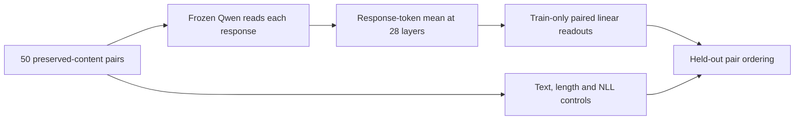
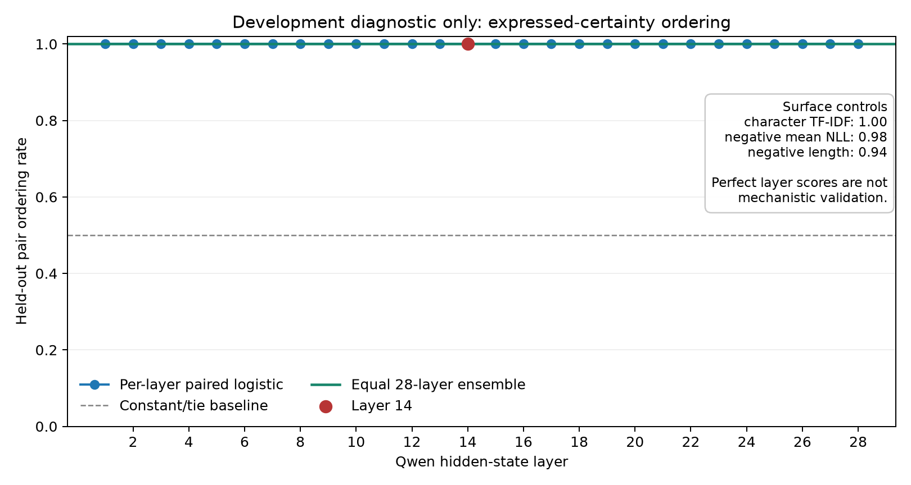

# Development diagnostic: diverse paired certainty

## Bottom line

**Layer 14 and the equal 28-layer ensemble both ranked all 50 confident/hedged
pairs correctly. The ensemble showed no gain over layer 14. This is a clean
development result, but not yet evidence for an abstract or mechanistically
useful confidence signal.**

The reason for caution is simple: a character-only TF-IDF classifier also ranked
all 50 pairs correctly, negative mean NLL ranked 49/50, and response length alone
ranked 47/50. Every hidden-state layer reached 50/50. The current rewrite set is
therefore too easy to distinguish layer choice or internal representation from
surface form.

This is not a failed run. It shows that Qwen represents the expressed certainty
contrast consistently across unseen source content. It also identifies the next
measurement problem before an SDT loss is attempted.

## What was tested

The development set contains 50 real-source assistant responses across five task
categories. Each source has a more confident and a more hesitant version intended
to preserve the same answer content. Ten pairs were revised after agent-assisted
content QA; all 50 then passed a second agent check. **Individual human review is
still pending.** Original and rewritten response text remains local and is not
published in this repository.

Frozen Qwen2.5-1.5B reads the source prompt followed by each supplied response. It
does not generate an answer in this experiment. For every layer, the primary
feature is the mean hidden state over ordinary assistant-response tokens. The
prompt, end-of-turn marker and padding are excluded.

For training sources only, response features are standardized and converted into
a paired difference:

```math
d_{i,\ell}=z^{\mathrm{confident}}_{i,\ell}-z^{\mathrm{hedged}}_{i,\ell}.
```

A regularized linear logistic readout is fitted to mirrored rows
`(d, 1)` and `(-d, 0)`, without an intercept. Evaluation uses five folds,
stratified by task. Each source appears in exactly one test fold, and every
scaler and readout is fitted on the other four folds. A pair is correct when the
held-out confident response receives the higher score; a tie counts as one half.



## Results

| Readout or control | Correct pair order | Interpretation |
|---|---:|---|
| Layer 14 linear readout | **50/50 (100%)** | Perfect on this development set |
| Equal 28-layer ensemble | **50/50 (100%)** | No observed gain over layer 14 |
| Every individual layer | **50/50 (100%)** | No preferred layer can be identified |
| Character TF-IDF | **50/50 (100%)** | Surface wording is sufficient |
| Negative mean answer NLL | **49/50 (98%)** | The confident version is usually more probable |
| Negative response length | **47/50 (94%)** | Length is a strong shortcut |
| Constant/tie baseline | 25/50 equivalent (50%) | Chance reference |

In 47 of 50 pairs the hesitant response is longer, with a median increase of
71.5 characters. This makes the length result unsurprising and confirms that
the present set is not counterbalanced for a key nuisance variable.

The source-group bootstrap intervals are `[1.00, 1.00]` for layer 14 and the
ensemble because every observed pair is a success. These intervals only resample
this selected 50-pair set; they do not include readout-refitting uncertainty and
must not be read as perfect population performance.

Twenty descriptive shuffled-orientation runs were also made. None matched 100%
for layer 14, while 2/20 matched 100% for the ensemble. The ensemble's shuffled
95th percentile was itself 100%. With only 20 repeats and a strong shared rewrite
direction, this control is inconclusive and is not a formal p-value.



## What this establishes

- The 28-layer extraction, caching and group-disjoint cross-validation pipeline
  runs end to end.
- Expressed certainty in these rewrites is linearly separable across held-out
  source content.
- Layer 14 is sufficient on this set; the multi-layer ensemble adds nothing
  observable because the task is already at ceiling.

## What this does not establish

- It does not show that the readout captures the model's private belief or the
  probability that an answer is correct.
- It does not show information beyond explicit wording, length or likelihood.
- It does not validate evidence-sensitive confidence or a training-loss target.
- It does not justify SDT loss training, activation steering or causal claims.

The same configured model family performed the rewrites and agent-assisted QA,
which may preserve shared stylistic artifacts. The current pairs are development
data, not a frozen final test set, and human review remains pending.

## Decision and next experiment

**Do not scale this rewrite recipe to 1,000 pairs yet. Build a small independent,
counterbalanced cue/recipe-holdout challenge set first.**

The next set should use new source groups and certainty expressions absent from
training. It should balance which member of a pair is longer, vary where and how
certainty is expressed, include compositional cases where a single word such as
“certain” is not a reliable label, and receive blinded content/tone review.
Layer 14 and the frozen ensemble must then be compared against the same TF-IDF,
length and NLL controls without changing the scoring rule after results are seen.

Passing that challenge would justify larger paired-data construction. It would
still be a test of transferable **expressed certainty**. Evidence sensitivity,
answer correctness and usefulness as an SDT loss remain separate required tests.

The frozen follow-up specification is in
[`NEXT_CHALLENGE.md`](../NEXT_CHALLENGE.md).

Exact machine-readable metrics are in
[`DEVELOPMENT_DIAGNOSTIC.json`](../results/DEVELOPMENT_DIAGNOSTIC.json); the
implementation is in [`run_development_diagnostic.py`](../src/run_development_diagnostic.py).
